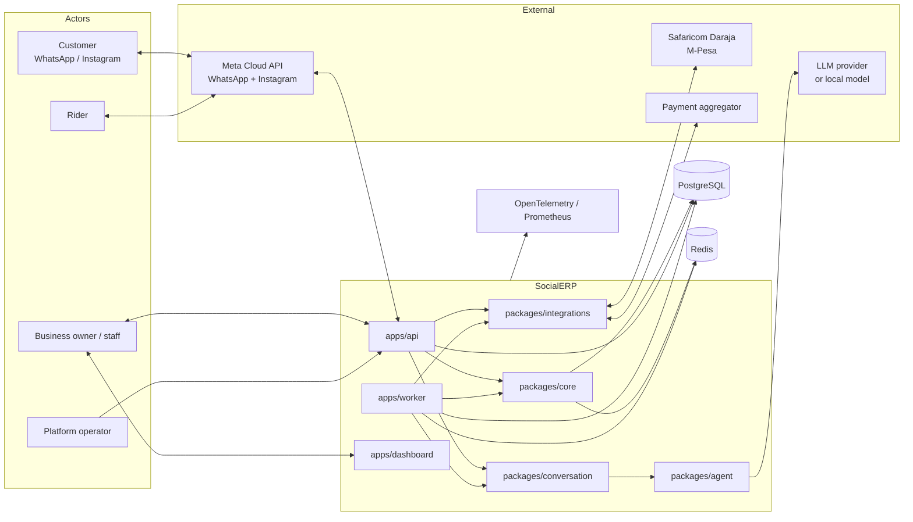
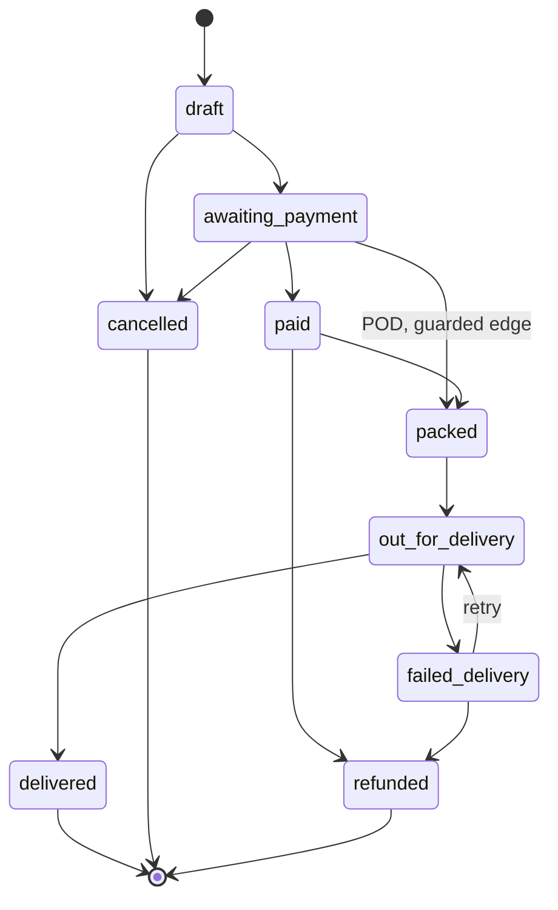
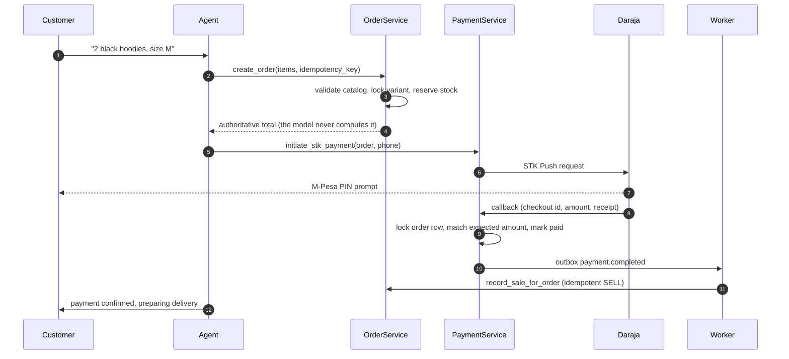

# Architecture

This is the deep end. It explains the design thesis, the module boundaries, the invariants
the code is built to protect, and where to read each part. For the current measured state
(including what is not finished), see [`docs/STATE.md`](docs/STATE.md) and
[`docs/UNCERTAINTY.md`](docs/UNCERTAINTY.md).

---

## 1. Design thesis

The product is an ERP driven by language, but the system is engineered so that **language can
never be the authority for money, stock or a delivery promise**.

Three commitments follow from that:

1. **The model is an interpreter, not an accountant.** It turns messy customer text into a
   strict, validated intent. Deterministic code owns every number.
2. **State changes are durable and replay-safe.** Stock is a ledger, orders are a state
   machine, side effects go through an outbox, and every inbound/outbound message is
   idempotent.
3. **When the system is unsure, it stops.** Low confidence, a provider failure, a suspicious
   payment, or a prompt-injection attempt routes to a human with a safe holding message.

This is a modular monolith. The boundaries are drawn so that a domain can be split into a
service later without rewriting its callers.

---

## 2. System context



---

## 3. Module boundaries

```
apps/api        HTTP surface: routes, webhook receivers, auth, tracking
apps/worker     background jobs: outbox relay, reservation expiry, reconciliation, rider flow
apps/dashboard  owner PWA: landing, pricing, auth, legal/security pages

packages/core         domain and services; no external SDK dependencies
packages/integrations provider clients and faithful fakes (Meta, Daraja, aggregator, manual)
packages/conversation inbox, handoff, inbound agent pipeline, rider FSM
packages/agent        LLM gateway, intent, policy, tools, evals
```

**Dependency rule:** `apps` may depend on `packages`. `packages/core` must not import
`packages/integrations`, `packages/agent`, or `packages/conversation`. The agent reaches the
domain through an explicit tool boundary (for example `ServiceOrderCreator`), so the
dependency points *into* the core, not out of it.

The order domain must not import the delivery domain at module scope; a shared
`apply_order_transition` helper and an injectable lookup keep the ABI clean (ADR 0015).

---

## 4. Tenancy model

- **Tenant = one business.** Roles: owner, staff, rider. A customer is always an external
  party, never a login user.
- Every tenant table carries `tenant_id`. Services receive the tenant id explicitly; queries
  filter on it.
- Alembic migrations enable row-level security policies on tenant tables.
- Cross-tenant access is a release blocker and is tested.

> **Honest status.** The policies and the tenant-scoped queries exist, but the runtime role
> currently owns the tables and the policies are not `FORCE`d, so the *database* is not yet the
> last line of defence. Closing that (restricted role + `FORCE RLS` + tenant context on the
> public registration and worker paths) is milestone **M1**. See U76/U77/U82 in the
> uncertainty ledger.

Identity is unified per customer by normalized phone (`2547XXXXXXXX` / `2541XXXXXXXX`), with
channel handles linked by consent/evidence.

---

## 5. Domain primitives

Small value objects prevent a whole class of bugs:

| Primitive | Rule |
|---|---|
| `TenantId` | Typed tenant identity; never a bare string |
| `CustomerPhone` | Normalizes and validates Kenyan mobile numbers |
| `Money` | Integer cents, KES-aware, rejects floats and truncation bugs |
| `Quantity` | Non-negative integer with ledger semantics |
| `SKU` | Stable catalog identity |

Money and stock arithmetic is plain, tested code under `packages/core/domain/`.

---

## 6. Event-sourced stock ledger

Stock is not a mutable number. It is the sum of immutable movements.

```
available(variant) = SUM(receive) - SUM(reserve) + SUM(release) - SUM(sell) + SUM(adjust) ...
```

- A movement is append-only. Quantities are never overwritten.
- Creating an order writes a `RESERVE` movement and an `ACTIVE` reservation, in one
  transaction.
- Payment completion writes a `SELL` and closes the reservation.
- Cancel or timeout writes a `RELEASE`; a background job expires stale reservations.
- The stock pre-check happens under a `FOR UPDATE` variant lock **before any row is written**,
  so an out-of-stock order leaves nothing behind, and two concurrent orders cannot both take
  the last item.

Property-based tests exercise conservation and concurrency.

---

## 7. Order state machine



Only these transitions are legal. Illegal transitions raise and are tested. The authoritative
table lives in [`packages/core/orders/transitions.py`](packages/core/orders/transitions.py)
with ADR [0006](docs/adr/0006-order-state-machine.md) and
[0015](docs/adr/0015-order-transition-boundary-and-pod-fsm-edge.md).

---

## 8. The money path



Failure handling is part of the design:

- **Duplicate callback** — deduped by checkout id/receipt; no double credit.
- **Late callback after cancellation** — captured with an audit; order is not resurrected.
- **Missing callback** — a status-query job asks the provider and applies the same guards.
- **Amount mismatch** — never credited blindly; routed to human review.
- **Success on a terminal order** — money is captured on the payment, a durable CRITICAL
  `owner_alert` is raised, and a human decides refund vs honour.
- **Stale cancel/failure** — cannot downgrade a paid order.

The `PaymentProvider` interface supports three merchant paths: a licensed aggregator, the
merchant's own Daraja credentials, or a manual pay-to-Till fallback with operator
confirmation. Merchant funds are never pooled in a SocialERP shortcode. Our **SaaS
subscription** is a separate flow entirely.

---

## 9. Agent and policy

```
inbound text
   │
   ├─ injection / fraud / language detection        (deterministic)
   │
   ├─ intent extraction  ── strict schema, untrusted output validated
   │
   ├─ policy engine  ── autonomy level, risk, confidence, always-human set
   │
   ├─ tool call  ── validated, tenant-scoped parameters only
   │
   └─ reply  ── grounded in catalog/rules; safe fallback on failure
```

- **Autonomy:** `L0` shadow → `L1` answer → `L2` transact → `L3` optimize. Default `L0`.
- **Always human-approved:** refunds, discounts beyond the limit, price changes, bulk sends,
  data deletion, and anything the policy engine scores as high-risk or low-confidence.
- **Injection defence:** customer text is data. Attempts to change rules, reveal prompts, or
  reach another customer escalate to a human.
- **Language:** English, Swahili and Sheng-aware; mirror the customer; always offer a human.
- **Spend control:** per-tenant caps at the gateway; when the model is unavailable, a holding
  reply plus handoff.

Every agent action is logged with inputs, tool calls, output, policy decision and the rule
that allowed it. The audit log is append-only.

---

## 10. Delivery and pay-on-delivery

- Zones with fees, riders with normalized phone numbers, dispatch from `packed`.
- The rider runs the whole flow over WhatsApp with fixed quick replies
  (`picked`, `arrived`, `delivered`, `failed`, `status`) — no rider app, no LLM.
- On a pay-on-delivery order, `arrived` triggers an STK Push in a **post-commit** step so a
  retried message cannot double-prompt. The delivery row lock serializes concurrent arrivals.
- `delivered` requires collected payment and proof of delivery.
- Failed delivery distinguishes "never picked up" (order stays packed) from "failed in
  transit" (order becomes `failed_delivery`, retryable).
- Public tracking is PII-free and gated by a signed, expiring token bound to tenant + order.
  An unknown, tampered or expired token returns the same bare 404.

---

## 11. CRM memory

- Append-only customer events (messages summarized, products asked about, orders, payments,
  delivery outcomes, complaints).
- Consent is latest-wins and **default deny**; marketing sends require an affirmative record.
- Derived traits are versioned and evidence-carrying, restricted by an allow-list. Sensitive
  attributes are refused at two layers. Arithmetic (RFM, LTV, reorder cycle, churn) is
  deterministic.
- Data-subject rights: full export and owner-approved, audited erasure (including outbox and
  channel-table scrubbing as recorded in the uncertainty ledger).

---

## 12. Reliability patterns

| Pattern | Use |
|---|---|
| **Outbox** | Side effects (send a message, record a sale, alert an owner) are written in the same transaction as the state change and relayed by the worker. |
| **Idempotency** | Provider message id, checkout id/receipt, idempotency keys on order/payment/outbox handlers. |
| **At-least-once** | Handlers are idempotent, so replay is safe by construction. |
| **Fail-closed auth** | Signature verification, tenant checks, signed tracking tokens, rate limits. |
| **Observability** | Traces, metrics and alerts for message latency, agent errors, STK success, queue depth and cost. PII is redacted. |
| **Graceful degradation** | If a downstream provider or model fails, send a holding reply and hand off; never invent state. |

---

## 13. Deployment shape

- Stateless API and worker processes, separate health/readiness checks.
- PostgreSQL migrations run before rollout; the production runtime role should be restricted
  and non-owner (M1).
- Redis backs the queue and shared rate-limit counters.
- Secrets come from managed secret storage; only `.env.example` lives in the repo.
- Backups and a tested restore are a launch gate (M4).

The local `docker-compose.yml` is a development setup, not a production profile.

---

## 14. Invariants (the ones to keep)

1. No LLM arithmetic for money or stock. Ever.
2. Stock is a sum of immutable movements, never a mutable counter.
3. Only legal order transitions exist; illegal ones raise and are tested.
4. Every side effect is replay-safe (outbox + idempotency).
5. A payment is "paid" only on trusted provider evidence matched to the expected order.
6. Merchant funds are never pooled; SaaS billing is a separate flow.
7. Cross-tenant access fails closed.
8. Low confidence, injection, fraud signals and provider failure lead to a human, not a guess.
9. Nothing is "done" until `make check` passes and the real output is reported.
10. Open problems are written down, not hidden.

---

## 15. Where to read the code

1. [`packages/core/domain/`](packages/core/domain/) — value objects.
2. [`packages/core/events/`](packages/core/events/) — events and the outbox.
3. [`packages/core/orders/service.py`](packages/core/orders/service.py) — reservations and sale.
4. [`packages/core/payments/service.py`](packages/core/payments/service.py) — the money guards.
5. [`packages/core/delivery/`](packages/core/delivery/) — delivery, POD and tracking.
6. [`packages/core/crm/`](packages/core/crm/) — memory, consent, traits, erasure.
7. [`packages/agent/`](packages/agent/) — gateway, intent, policy, tools.
8. [`packages/integrations/`](packages/integrations/) — providers and fakes.
9. [`apps/api/routes/`](apps/api/routes/) — the HTTP surface.
10. [`tests/`](tests/) and [`evals/`](evals/) — the proof.
