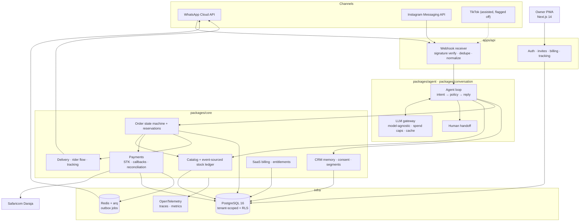

# SocialERP

**An agentic ERP that runs a Kenyan social seller's business inside WhatsApp.**

[](https://github.com/hustlestack01Intern/socialerp/actions/workflows/ci.yml)


> **Curator's note.** This repository is a working, heavily tested pilot candidate, not a
> marketing demo. It is also honest about what is not finished. The [status board](#what-is-real-today)
> below separates what the code enforces today from what is designed, from what is still open.
> The project keeps its own [uncertainty ledger](docs/UNCERTAINTY.md) and
> [failure postmortems](docs/failures/). Read those before believing any claim on this page.

---

## The problem

A small business in Nairobi already sells on WhatsApp. That is the storefront. But the
business behind the storefront is chaos:

- orders and questions arrive in a stream of chat threads;
- stock lives in a notebook, a spreadsheet, or the owner's memory;
- prices are quoted from the last message, not from a catalog;
- M-Pesa payments are checked by hand, screenshot by screenshot;
- riders are coordinated by phone call;
- "where is my order?" is answered from memory;
- customer history disappears when the owner changes phones or staff.

The practical cost is not abstract: **missed sales, oversold stock, wrong prices, slow
replies, manual payment chasing, and an owner who cannot step away.**

The Communications Authority of Kenya's 2024-25 customer survey reports WhatsApp at
**20.2% of e-commerce order placement** and mobile money as the preferred payment method for
**65.7%** of respondents. The channel fit is real. Willingness to pay is a hypothesis this
project intends to test with real merchants, not a fact it asserts.

---

## The product: one controlled loop

SocialERP puts a deterministic operating layer under the conversation the customer is
already having.

```
customer asks on WhatsApp
        │
        ▼
agent replies from the merchant's confirmed catalog and rules  (never invents a price)
        │
        ▼
deterministic code validates the variant, checks the stock ledger, computes the total
        │
        ▼
order created ──► stock reserved ──► M-Pesa STK Push (prepay or pay-on-delivery)
        │
        ▼
authenticated callback confirms payment ──► rider flow on WhatsApp ──► public tracking
        │
        ▼
customer memory, segments and owner insights get smarter for the next sale
```

The owner can run the business from the same chat: *"how many orders today?"*,
*"mark order 1042 delivered"*, *"restock 20 of SKU X"*.

---

## Why this is different from "a chatbot for shops"

The LLM is allowed to understand language. It is **never** allowed to be the source of truth
for money, stock, or delivery promises.

| Guardrail | What it means in the code |
|---|---|
| **No LLM arithmetic** | The model extracts structured intent. Deterministic code validates the catalog, checks stock, computes totals, creates the order and requests payment. |
| **Event-sourced stock ledger** | Stock is the sum of immutable movements (`receive`, `reserve`, `release`, `sell`, `adjust`, `return`). Quantities are never overwritten. |
| **Explicit order state machine** | Only legal transitions exist (`draft → awaiting_payment → paid → packed → out_for_delivery → delivered`, plus cancellation/refund/failure edges). Illegal transitions raise. |
| **Idempotency everywhere** | Inbound webhooks dedupe by provider message id; payment requests carry idempotency keys; callbacks dedupe by checkout/receipt; the outbox makes side effects replay-safe. |
| **Money safety over liveness** | A late, stale or duplicated STK callback can never downgrade, lose, or double-spend an order. Captured-but-not-collectable money is alerted to a human, never silently sold. |
| **Tenant-scoped by design** | Every tenant table carries `tenant_id`, RLS policies exist, and cross-tenant attempts are tested to fail closed. (Database *enforcement* is the M1 work — see the status board.) |
| **Human approval for the sharp edges** | Refunds, discounts beyond a configured limit, price changes, bulk sends and data deletion are always human-approved. |
| **Autonomy ladder** | `L0` shadow (drafts, owner approves) → `L1` answer (catalog-grounded FAQs) → `L2` transact (orders, stock, STK) → `L3` optimize. Default is `L0`, promoted only by the owner. |
| **Prompt injection is an input, not an instruction** | Customer text is data. Injection markers escalate to a human; tools only receive validated, tenant-scoped parameters. |
| **Fail safe** | If the model is down or unsure, send a safe holding message and hand off. Never improvise on prices, stock, payments or delivery. |

This is the moat. Not the chat interface — the **deterministic core the chat is not allowed to
bypass.**

---

## System architecture



### The money path, in one paragraph

An order is created with an `ACTIVE` reservation and an outbox event; `PaymentService`
initiates the STK Push **without** holding a row lock across the provider network call; the
Daraja callback locks the order row, verifies the amount against the expected order, and only
then marks it paid. A cancelled or failed callback for an already-paid order is ignored and
audited. A success on a terminal order is captured on the payment, the order is left alone, and
a durable owner alert tells a human to decide refund-versus-honour. A status-query fallback
covers missing callbacks, and a daily reconciliation job compares our ledger with provider
statements.

---

## The capability tour

| Module | What it does | Where it lives |
|---|---|---|
| **Channels** | Official WhatsApp Cloud API and Instagram Messaging API; signature verification, 24-hour window tracking, template-only out-of-window sends, dedupe. | `packages/integrations/meta/` |
| **Conversation** | Unified inbox, conversation state, human handoff, rider quick-reply FSM. | `packages/conversation/` |
| **Agent** | Model-agnostic LLM gateway, strict intent schema, policy engine, deterministic tools, evals. | `packages/agent/` |
| **Catalog & stock** | Products, variants, prices, event-sourced stock movements and reservations. | `packages/core/` |
| **Orders** | Legal-transition state machine, reservation expiry, concurrent last-item safety. | `packages/core/orders/` |
| **Payments** | `PaymentProvider` interface (Daraja, aggregator, manual), STK prepay and pay-on-delivery, refunds, statement reconciliation. | `packages/core/payments/`, `packages/integrations/` |
| **Delivery** | Zones and fees, riders, pickup/arrival/delivery, POD trigger, proof of delivery, PII-free public tracking. | `packages/core/delivery/` |
| **CRM memory** | Append-only events, consent, versioned evidence-backed traits, segments, export and erasure. | `packages/core/crm/` |
| **Insights** | Deterministic daily/weekly reports, low-stock alerts, order-count anomaly detection. | `packages/core/insights/` |
| **Owner console** | Policy-gated WhatsApp commands: read the day, mark delivered, restock. | `packages/agent/` + `packages/conversation/` |
| **Billing** | Our SaaS subscription (separate from merchant customer payments), entitlements and plan-state gates. | `packages/core/billing/` |
| **Onboarding** | Instrumented wizard with fallbacks; invite-gated registration. | `apps/dashboard/`, `apps/api/routes/onboarding.py` |

---

## What is real today

This is the part most repositories hide. Here is the measured state at the published baseline.

### Enforced in code and covered by tests

- Event-sourced stock ledger, order state machine, reservations and concurrent last-item race.
- STK Push, authenticated callbacks, duplicate/late/stale handling, status-query fallback,
  statement reconciliation, human-approved refunds.
- WhatsApp webhook verification, dedupe, 24-hour window, template enforcement; Instagram
  channel code with plan-gated access.
- Rider WhatsApp quick replies, POD arrival trigger, PII-free signed-token tracking.
- CRM events, consent (default deny), versioned traits with evidence, export and erasure.
- Plan-state gate, per-cell entitlements (channels, agent level, seats, API, insights),
  one-business-per-WhatsApp-number.
- Invite-gated, audited, single-transaction registration; shared Redis rate limiting on auth;
  refresh token in an `HttpOnly` cookie and out of the response body.

### Built, but not yet proven in the real world

- **Live multi-tenant WhatsApp routing.** The channel code exists; routing each merchant's
  own verified account with protected credentials is **M2**.
- **Instagram in production.** Requires Meta business assets and approval.
- **30-minute self-serve onboarding.** The wizard is instrumented; the target is unmeasured.
- **TikTok.** Assisted mode only, behind a flag, off by default.

### Open and blocking the first paid pilot

- **Database-enforced tenant isolation.** Policies and tenant-scoped queries exist, but the
  runtime role owns the tables and RLS is not `FORCE`d (U76/U77/U82). This is **M1**.
- **Provider-verified subscription payment.** A submitted M-Pesa reference is a claim, not
  proof of funds (M3).
- **Trial policy.** Code says 14 days from channel connect; the pilot proposal asks for
  7 days from readiness. A human decision.
- **Data-protection and production operations.** Retention map, counsel classification,
  restore drills, incident runbooks (M4).

> **Read the live ledger:** [`docs/STATE.md`](docs/STATE.md) ·
> [`docs/UNCERTAINTY.md`](docs/UNCERTAINTY.md) ·
> [`docs/THREAT_MODEL.md`](docs/THREAT_MODEL.md) ·
> [`docs/failures/`](docs/failures/)

---

## Tech stack

| Layer | Choice | Why |
|---|---|---|
| Language | Python 3.13, `mypy --strict` | One runtime for API, worker and domain ([ADR 0022](docs/adr/0022-python-313-runtime.md)) |
| API | FastAPI + pydantic v2 | Typed contracts at the webhook and tool boundaries |
| Data | PostgreSQL 16 + SQLAlchemy 2 + Alembic | RLS, migrations, transactions, JSONB |
| Queue | Redis + arq | Durable outbox processing and scheduled jobs |
| Frontend | Next.js 14 + TypeScript + Tailwind | Mobile-first owner PWA |
| Integrations | Official Meta Cloud API, Safaricom Daraja, aggregator + manual fallback | No unofficial WhatsApp automation, ever |
| Observability | OpenTelemetry, Prometheus | Traces, metrics, redacted PII |
| Testing | pytest, Hypothesis, fakes for Meta and Daraja | Property tests for money and stock; no live endpoints in CI |

---

## Quickstart

```bash
git clone https://github.com/hustlestack01Intern/socialerp.git
cd socialerp

cp .env.example .env          # dev defaults; never commit .env
uv sync                       # install the Python workspace
make db-up                    # PostgreSQL + Redis via docker compose
make migrate                  # Alembic upgrade head

make run-api                  # FastAPI on :8000
make run-worker               # arq worker (separate shell)
make run-dashboard            # Next.js on :3000 (requires pnpm install)
```

Run the full quality gate exactly as CI does:

```bash
make check                    # ruff + eslint + mypy + tsc + pytest + evals
```

No live payment, messaging or tax endpoint is called unless you explicitly configure
credentials. Development and CI use **synthetic data and fake provider servers**.

---

## Repository map

```
.
├── apps/
│   ├── api/              FastAPI app: routes, webhooks, auth, billing, tracking
│   ├── worker/           arq jobs: outbox, reservations, reconciliation, rider flow
│   └── dashboard/        Next.js owner PWA (landing, pricing, auth, legal pages)
├── packages/
│   ├── core/             Domain primitives, events/outbox, security, orders, payments,
│   │                     delivery, CRM, insights, billing, auth, alerts, middleware
│   ├── integrations/     Meta, Daraja, aggregator, manual provider, fake servers
│   ├── conversation/     Inbox, handoff, agent pipeline, rider FSM
│   └── agent/            LLM gateway, intent, policy, tools, evals
├── alembic/              Database migrations (RLS policies live here)
├── tests/                Unit, integration, contract, property, architecture guards
├── evals/                Labelled conversation sets and the evaluation runner
├── docs/                 Spec, state, ADRs, threat model, plans, postmortems, runbooks
├── scripts/              Ops and proof scripts (sales spine, RLS, migrations)
├── infra/                Local Postgres/Redis init and deployment scaffolding
├── .github/workflows/    CI: lint, typecheck, tests, dashboard, Docker build
├── Makefile              The gate and the run targets
└── .env.example          The only environment file allowed in the repo
```

**A note on `.opencode/` and `opencode-setup-pack-v2/`:** these are the optional agentic
development toolkit used to build the project. They are not part of the runtime.

---

## The quality gate

The gate is the product. Nothing is "done" until it passes and the real output is reported.

```
ruff check .                     All checks passed!
pnpm lint (eslint)               No ESLint warnings or errors
mypy packages apps (strict)      Success: no issues found in 137 source files
pnpm typecheck (tsc --noEmit)    clean
pytest                           1029 passed
python -m evals.runner           8/8 cases; wrong price/stock hallucinations: 0
```

Measured at `a39db67` on 2026-11-01. The current U79 commit adds assertions for the
refresh-token response body. Re-run `make check` on a clean database for a current number;
a previous green run is evidence, not a guarantee.

**The invariant that matters most:** on the labelled evaluation set, the agent produces
**zero wrong prices and zero wrong stock claims**. This is a hard fail in `make eval`.

---

## Security and privacy posture

- Only `.env.example` is committed. The repository is scanned before publishing; no secrets,
  keys or tokens are tracked.
- Customer data is synthetic everywhere except an explicitly authorized pilot.
- Phone numbers and PII are redacted from logs and traces; tracking tokens are removed from
  URL attributes.
- Threat model, data-subject rights (export/erasure), consent (default deny) and an
  append-only audit log are part of the design, not an afterthought.
- **Open security work is listed, not hidden:** see the status board above and
  [`SECURITY.md`](SECURITY.md).

If you find a vulnerability, please follow [`SECURITY.md`](SECURITY.md) rather than opening
a public issue with exploit details.

---

## Roadmap to the first paid pilot

| Milestone | State |
|---|---|
| **M0** — Freeze truth, one measured release baseline | Done |
| **M1** — Restricted DB role, `FORCE` RLS, tenant context on every path | Next; protected zone, needs human go |
| **M2** — Tenant-owned WhatsApp accounts and independent routing | Planned |
| **M3** — Provider-verified subscription payment and audited operator approval | Planned |
| **M4** — Data protection and production operations | Planned, partly parallel |
| **M5** — One honest trial policy and one WhatsApp pilot SKU | Planned |
| **M6** — Full-flow proof on migrated staging and provider sandboxes | Planned |
| **M7** — Concierge pilot: three merchants, seven-day trials | Planned |
| **M8** — Decide whether to scale on measured contribution, not projected MRR | Planned |

The full plan, acceptance criteria, rollback matrix and incentive review:
[`docs/plans/2026-10-23-production-pilot-launch.md`](docs/plans/2026-10-23-production-pilot-launch.md).

---

## The museum wing

This repository keeps its thinking in public. Start with the curated tour:

- **[The guided tour](docs/TOUR.md)** — a 45-minute reading path through the whole project.
- **[Docs index](docs/README.md)** — every document, organised as wings of the museum.
- **[System map](docs/MAP.md)** — modules, boundaries and data flows.
- **[Architecture](ARCHITECTURE.md)** — the deep dive: invariants, tenancy, money path, agent.
- **[Spec](docs/SPEC.md) and [Constitution](docs/CONSTITUTION.md)** — what we build and how.
- **[ADRs](docs/adr/)** — every significant decision, with its consequences.
- **[Plans](docs/plans/)** — the ordered work, with acceptance tests.
- **[Failure postmortems](docs/failures/)** — what broke, why, and what changed.
- **[Runbooks](docs/RUNBOOKS/)** — reconciliation and refunds, for humans on call.

---

## Contributing

Read [`CONTRIBUTING.md`](CONTRIBUTING.md) and [`docs/CONSTITUTION.md`](docs/CONSTITUTION.md).
In short: plan first, write the test first, keep one concern per commit, run `make check`,
never fake a result, never commit a secret, and get human approval before touching a
protected zone (tenancy, money, privacy, auth, tests, the gate).

---

## License

[MIT](LICENSE) © 2026 JohnMark Ezvaldo Ochieng.

Built for the sellers who already do business in the chat app — and for the engineers who
believe an AI product should be *more* deterministic, not less.
