# SYSTEM MAP

## Purpose
SocialERP - Agentic ERP for WhatsApp/Instagram/TikTok sellers in Kenya.
Multi-tenant cloud ERP run by AI agents, letting Nairobi sellers run orders, stock, and M-Pesa payments entirely inside WhatsApp.

## Module List with Owners and Boundaries

```
socialerp/
├── apps/
│   ├── api/           # FastAPI application (HTTP endpoints, webhooks, owner pages)
│   ├── worker/        # Background job worker (ARQ/asyncio)
│   └── dashboard/     # Owner dashboard (Jinja2 + HTMX, server-rendered)
├── packages/
│   ├── core/          # Domain primitives, events, security (NO external deps)
│   │   ├── domain/    # Value objects: TenantId, CustomerPhone, Money, Quantity, SKU
│   │   ├── events/    # DomainEvent, OutboxEvent, EventRegistry
│   │   ├── security/  # HMAC, encryption, injection defense, PII redaction
│   │   ├── orders/    # OrderService (reserve/sell/cancel/expiry), FSM transitions, `is_order_paid`
│   │   ├── payments/  # PaymentService (protected zone): STK flows, callbacks, reconciliation
│   │   ├── alerts/    # AlertService: durable, deduped, tenant-scoped owner alerts (RLS 0011)
│   │   ├── delivery/  # DeliveryService: zones, riders, FSM, POD gates + tracking projection (no PII)
│   │   │   └── tracking_token.py  # HMAC-SHA256 signed, expiring `?t=` capability tokens (U29)
│   │   └── crm/       # CRMService: events, consent, versioned evidence-backed traits, export/erasure (RLS 0012)
│   │       ├── segments.py        # Phase 8b: fixed enum rules + pure JSON predicate evaluator
│   │       └── segment_service.py # Phase 8b: tenant-scoped batch latest-trait evaluation (no persistence)
│   ├── integrations/  # External API clients and fakes
│   │   ├── meta/      # WhatsApp/Instagram Graph API client
│   │   │   ├── webhook.py        # Webhook receiver + signature verification
│   │   │   ├── window_tracker.py # 24h window + rate limiter
│   │   │   └── sender.py         # Outbound sender + template enforcement
│   │   ├── daraja/    # Safaricom Daraja STK Push client
│   │   ├── aggregator/  # Payment aggregator client + factory + webhook (Pesapal-style)
│   │   ├── manual/      # Pay-to-Till-and-confirm manual provider
│   │   ├── provider_resolver.py  # Shared per-tenant PaymentProvider resolution (API + worker)
│   │   ├── fake_meta/    # Fake Meta server (M0)
│   │   └── fake_daraja/  # Fake Daraja server (M0)
│   ├── conversation/  # Unified inbox + handoff
│   │   ├── manager.py       # Conversation state + inbox
│   │   ├── handoff.py       # Human handoff workflow
│   │   ├── agent_service.py # Inbound WhatsApp → agent → reply pipeline (ADR 0014)
│   │   └── rider_flow.py    # Rider quick-reply FSM (no LLM) + post-commit POD STK trigger
│   └── agent/         # LLM gateway, prompts, tools, policy, evals
├── infra/             # Infrastructure as code (Docker, Kubernetes, Terraform)
├── tests/             # Unit, integration, contract tests
├── evals/             # LLM evaluation sets and runner
└── docs/              # SPEC, ADRs, THREAT_MODEL, STATE, MAP, UNCERTAINTY
```

## Dependency Graph (Mermaid)

```mermaid
graph TD
    %% Apps
    api[apps/api] --> core
    api --> integrations
    api --> conversation
    api --> agent
    worker[apps/worker] --> core
    worker --> integrations
    worker --> agent
    worker --> conversation
    dashboard[apps/dashboard] --> core
    
    %% Packages
    core[packages/core]
    integrations[packages/integrations]
    conversation[packages/conversation]
    agent[packages/agent]
    
    %% Core submodules
    core --> domain[packages/core/domain]
    core --> events[packages/core/events]
    core --> security[packages/core/security]
    core --> orders[packages/core/orders]
    core --> payments[packages/core/payments]
    core --> delivery[packages/core/delivery]
    core --> crm[packages/core/crm]
    
    %% Integrations submodules
    integrations --> meta[packages/integrations/meta]
    integrations --> daraja[packages/integrations/daraja]
    integrations --> aggregator[packages/integrations/aggregator]
    integrations --> manual[packages/integrations/manual]
    integrations --> fake_meta[packages/integrations/fake_meta]
    integrations --> fake_daraja[packages/integrations/fake_daraja]
    
    %% Conversation submodules
    conversation --> manager[packages/conversation/manager]
    conversation --> handoff[packages/conversation/handoff]
    conversation --> agent_service[packages/conversation/agent_service]
    conversation --> rider_flow[packages/conversation/rider_flow]
    
    %% External
    meta --> WhatsApp[(WhatsApp Cloud API)]
    daraja --> Daraja[(Safaricom Daraja)]
    aggregator --> Aggregators[(Payment Aggregators)]
    
    %% Fake servers (M0 only)
    fake_meta -.-> WhatsApp
    fake_daraja -.-> Daraja
    
    %% Enforcement: no cycles, core has no external deps
    %% orders must not import delivery at module scope (ADR 0015; boundary test enforces it)
    classDef noexternal fill:#e8f5e9,stroke:#2e7d32;
    class core,domain,events,security noexternal;
```



## Data Flows

### Inbound Message (WhatsApp)
```
WhatsApp → Fake Meta /webhook → apps/api webhook endpoint
    → Signature verification (packages/core/security)
    → Normalize to MessageReceived event (packages/core/events)
    → packages/agent: intent extraction
    → packages/core/events: AgentActionLogged
    → Response generation
    → Fake Meta /messages → WhatsApp
```

### STK Push Payment
```
apps/api: Order created → outbox `order.created` + ACTIVE reservation rows
    → PaymentService.initiate_stk_payment (does NOT lock the order row —
      must not hold a lock across the provider network call)
    → packages/integrations/daraja: STK Push request
    → Daraja /stkpush → CheckoutRequestID
    → Async callback → Daraja /callback
    → apps/api callback endpoint → PaymentService.handle_callback
        (same guards in apply_query_result, the status-query fallback)
        → order row locked FOR UPDATE (paid-check + write are atomic)
        → cancel/failure on an already-paid order? IGNORED + audit
          payment.stale_failure_ignored (cannot downgrade a paid order)
        → cancel while another attempt is INITIATED/PENDING? DEFERRED
          + audit payment.cancel_deferred (retry's cancel can't kill the order)
        → success but order is neither awaiting_payment nor POD out_for_delivery?
          CAPTURE on Payment (metadata collected_after_terminal=True),
          order left untouched, outbox payment.collected_after_terminal
          → worker persists a DURABLE CRITICAL owner_alert row (dedupe
            payment_collected_after_terminal:{order_id}) + logs WARNING
            (human: refund vs manual honour; GET /api/v1/alerts; U15)
        → otherwise: collect on the order (payment_status = completed) →
            prepay: awaiting_payment → paid (FSM transition)
            POD in transit: paid_at recorded, status unchanged (paid comes
              only via rider "delivered")
          → outbox `payment.completed`
    → StockMovementRecorded (sell)  [worker: handle_payment_completed]
    → Reservation fulfilled (closed by the sale, not released)
```

### Delivery + Pay-on-Delivery (arrive → STK Push)
```
apps/api: POST /api/v1/delivery/orders/{order_id}/dispatch  (idempotent; order packed)
    → DeliveryService.dispatch → Delivery row status=assigned
    → POST .../deliveries/{id}/picked-up   assigned → picked_up
    → POST .../deliveries/{id}/arrived     picked_up → arrived (FOR UPDATE lock), then:
        → order is mpesa_pod AND unpaid?
            → resolve PaymentProvider LAZILY (only in this branch; prepay never needs one)
            → PaymentService.initiate_stk_payment(
                  idempotency_key = "delivery:{delivery_id}:arrived")
            → STK sent (stk in response); provider error → stk_error, arrival still commits
        → else (prepay / already paid): no provider resolution, no STK
        → single db.commit() at the end (arrival + initiation in one transaction;
          the delivery row lock serializes concurrent arrivals → exactly one push; see U19)
    → Daraja callback → PaymentService.handle_callback → order paid (POD)
    → POST .../deliveries/{id}/delivered  (requires payment collected + proof)
    → order delivered (sale side effect from payment.completed)

Failure: POST .../deliveries/{id}/failed
    → previous status assigned?  → order untouched (stays packed; no packed→failed_delivery edge)
    → previous picked_up/arrived? → order → failed_delivery
    → POST .../deliveries/{id}/retry → delivery failed→picked_up, order packed→out_for_delivery
```

### Rider WhatsApp Quick Replies (no LLM)
```
WhatsApp → webhook → outbox `inbound_message:{provider_message_id}`
    → worker handle_inbound_message
        → RiderFlowService.try_handle (ONLY if sender phone matches an active/inactive rider)
            → parse_rider_command (fixed EN/SW keyword map: picked|arrived|delivered|failed|status)
            → mark_picked_up / mark_arrived(lock=True) / mark_delivered / mark_failed / status
            → reply stored as an outbound WhatsAppMessage (metadata_json.rider_flow=action)
            → if action == arrived on a POD+unpaid order: collection_due=True, NO inline STK
        → worker commits, THEN, iff collection_due:
            trigger_pod_collection(tenant_id, delivery_id)  (own transaction, key
            "delivery:{id}:arrived") → STK  [post-commit ⇒ a retry cannot double-prompt]
        → rider "delivered" on POD raises ProofOfDeliveryRequiredError → reply POD_NEEDS_SHOP
        → non-rider / inactive-rider / no-active-delivery fall through to the customer agent
```

### Public Order Tracking (no auth; token-gated; PII-free)
```
GET /api/v1/tracking/{order_id}?t=<token>  → JSON projection (agent/dashboard embed)
GET /tracking/{order_id}?t=<token>         → self-contained HTML status page
    → build_tracking(session, order_id, token): VERIFY token FIRST against the order's
      OWN tenant_id (packages/core/delivery/tracking_token.py, HMAC-SHA256 v1,
      bound to tenant+order, constant-time) → then order status + delivery status
      + zone name + payment method + timestamped timeline
    → EXCLUDES customer name/phone/address and rider identity/location (no PII)
    → token missing/malformed/tampered/expired/wrong-tenant AND unknown order → SAME bare 404
      (fail closed; U29 RESOLVED 2026-10-18, commit `19d88ff`; token-in-logs residual = U35)
```

### CRM Memory (customer events, consent, versioned traits, DSR)
```
Inbound/order/payment side effects → CRMService.record_event(...)  (idempotent on dedupe_key)
    → customer_events row (append-only; raw SQL UPDATE/DELETE rejected by trigger;
      DELETE only via the app.allow_event_erasure GUC)
Consent: POST /api/v1/crm/customers/{id}/consent | /opt-out → consent_records
    (latest-wins per (customer, purpose); absence = DENIED → has_consent() gates sends)
Derive: POST /api/v1/crm/customers/{id}/derive
    → deterministic RFM/LTV/reorder-cycle/churn from ORDERS (no LLM arithmetic)
    → each trait APPENDS a versioned, evidence-carrying customer_traits row (allow-list only)
Reads (staff):  GET /memory (latest traits + consent + recent events, chronological)
                GET /events (append-only log) · GET /traits (all versions + evidence)
Data-subject rights (owner): GET /export (full record)
    DELETE /api/v1/crm/customers/{id}  → human-approved erase:
        GUC app.allow_event_erasure=on → DELETE events/traits/consents → anonymise customer
        (phone → `erased-<12hex>` tombstone, name/email/address NULL, is_active=false) →
        scrub orders.customer_phone/name → audit `crm.customer_erased`
    ⚠ KNOWN GAPS (U30–U33, OPEN — protected zone, awaiting approval): payments.phone_number,
      orders.customer_email/delivery_address and the audit-log `before` phone survive;
      export truncates at the oldest 200 events. See docs/UNCERTAINTY.md.
```

### Owner Alerts (durable, tenant-scoped, acknowledgeable)
```
Any handler/service → AlertService.raise_alert(tenant_id, kind, severity, title,
      body, dedupe_key?) → owner_alerts row (idempotent per (tenant_id, dedupe_key);
      race-safe via savepoint; audit alert.raised)
GET  /api/v1/alerts?status=open   → this tenant's alerts, newest first
POST /api/v1/alerts/{id}/ack      → OPEN → ACKNOWLEDGED (records acknowledged_at/by; audit)
worker handle_payment_collected_after_terminal → raise_alert(CRITICAL,
      dedupe payment_collected_after_terminal:{order_id})
RLS: migration 0011 (policy + socialerp_app grants); dedicated non-owner-role RLS test
```

### Segments + Owner Insights (Phase 8b — read-only, ADR 0018)
```
GET /api/v1/segments                   → static segment catalogue (owner-only)
GET /api/v1/segments/{key}/members     → member customer IDs (sorted, paginated)
    → SegmentService.latest_traits_by_customer(tenant): ONE batched customer_traits
      SELECT; highest version per (customer, name) wins (same rule as CRMService)
    → evaluate_predicate(rule.predicate, traits)  PURE: and/or + comparisons over
      ALLOWED_TRAITS only; a MISSING trait never matches (no `not` operator);
      NOTHING is persisted (no segments table, no migration)

GET /api/v1/insights/daily?date=        day report: orders, PAID-only revenue, AOV,
                                        new/returning, top items + order anomaly
GET /api/v1/insights/weekly?week_start= 7-day report (no anomaly)
GET /api/v1/insights/stock-alerts       active variants quantity < reorder_level
    → InsightsService (packages/core/insights/service.py): computed on the fly, all
      tenant_id-scoped, paid = is_order_paid, money in integer cents, LLM never runs
    → anomaly = today's order COUNT vs trailing 14-day median; spike >2x, drop <1/2x,
      refused below a median of 5; NO durable owner_alerts row is written.
```

### Stock Movement (Event Sourcing)
```
Any stock change → StockMovementRecorded event (immutable)
    → OutboxEvent → Outbox table (same transaction)
    → Worker processes outbox → Projects to read models
    → Available stock = SUM(movements)
```

### WhatsApp Conversation Flow
```
Inbound → Webhook → MessageReceived → ConversationManager
    → WindowTracker.check_window() → Sender.send_text/template
    → ConversationStateMachine.update_state()
    → HandoffManager.request_handoff() (if needed)
    → Conversation.state = HANDOFF_REQUESTED
    → Owner notified → accept → HANDOFF_ACTIVE
    → Owner resolves → CLOSED or AWAITING_RESPONSE
```

## External Integrations

| Integration | Protocol | Auth | Key Files |
|-------------|----------|------|-----------|
| WhatsApp Cloud API | HTTPS/JSON | HMAC-SHA256, Bearer | `packages/integrations/meta/` |
| Instagram Graph API | HTTPS/JSON | OAuth2, HMAC | `packages/integrations/meta/` |
| Safaricom Daraja | HTTPS/JSON | OAuth2, HMAC | `packages/integrations/daraja/` |
| Payment Aggregators | HTTPS/JSON | API Key, HMAC | `packages/integrations/aggregator/` |
| Manual pay-to-Till | none (operator confirms) | fail-closed token | `packages/integrations/manual/` |

## Where to Start Reading

1. **SPEC.md** - Product specification and roadmap (M0-M6, GATE G1)
2. **CONSTITUTION.md** - Engineering principles and workflow
3. **packages/core/domain/__init__.py** - Domain primitives (Money, Phone, SKU)
4. **packages/core/events/__init__.py** - Event system and outbox pattern
5. **packages/core/security/__init__.py** - Security utilities
6. **docs/adr/0001-lean-mvp.md** - M0 plan
7. **docs/adr/0002-stack-choices.md** - Technology decisions
8. **docs/adr/0003-fake-servers.md** - Fake server design
9. **docs/adr/0007-whatsapp-webhook-design.md** - Webhook signature verification
10. **docs/adr/0008-24h-window-tracking.md** - 24h window + rate limiting
11. **docs/adr/0009-conversation-handoff-design.md** - Conversation state + handoff
12. **docs/adr/0013-order-creation-reservation-and-sale.md** - Ledger + reservation + sale
13. **docs/adr/0006 + 0015** - Order FSM (amended) + transition helper + POD edges
14. **packages/core/payments/service.py** - PaymentService and the money-path guards
15. **apps/api/routes/delivery.py** - delivery/zones/riders routes + the arrive→STK POD trigger
16. **packages/conversation/rider_flow.py** - rider quick replies + `trigger_pod_collection`
17. **packages/core/delivery/tracking.py + tracking_token.py + apps/api/routes/tracking.py** - public PII-free tracking, signed-token gated (U29)
18. **packages/core/alerts/** + **apps/api/routes/alerts.py** - durable owner alerts (0011 RLS)
19. **packages/core/crm/** + **apps/api/routes/crm.py** - CRM memory: events/consent/traits (0012 RLS), export + owner-approved erasure
20. **docs/adr/0018-segments-insights.md** + **packages/core/crm/segments.py + segment_service.py** +
    **packages/core/insights/** + **apps/api/routes/{segments,insights}.py** - Phase 8b segments (fixed
    enum rules, read-time evaluation) and deterministic owner reports/anomaly (committed `8dbc120`,
    routers wired at `main.py:165-166`, 37+38 tests green in wave-2 gate)

## Current Phase (updated 2026-10-19 — measured truth)

**Gate is RED at HEAD `c955fbd` with a dirty working tree** (uncommitted Slice-A fragment).
Measured 2026-10-19: `uv run ruff check .` → 34 errors / 15 files; `uv run pytest tests/contract -q`
→ 10 failed, 1 passed; full suite (subagent) → 788 passed, 15 failed, 22 errors; Makefile lines
109/113/117/121/125/147/151/170 reference deleted `infra/docker-compose.yml` and
`packages/core/alembic.ini`. Evidence: `docs/failures/2026-10-19-stale-green-gate.md`.

- **Phase 9 (Instagram + onboarding wizard)**: commits `c4db565..d1344fd` (+ docs `c955fbd`)
  are **merged but were never full-gate-verified** — do not treat as complete.
- **Phase 10**: **not started**, except an uncommitted Slice-A fragment in the working tree.
- **Billing / trial / entitlement: does not exist** in the codebase.
- **Next**: M0 (gate truth) → M1 trial spine (B1 tenancy + D-min billing) → M1.5 sales surface
  → M2 pre-go-live gate, per `docs/plans/2026-10-19-trial-spine-first-clients.md`
  — **awaiting human go** (protected zones: billing, tenant-isolation tests, CI gate).
- Prior "764 green" claim (at `e7170d2`) is **superseded** — it predates Phase 9.

### HISTORICAL — phase checklist as of 2026-10-18 (gate claims below were measured at `e7170d2` and are superseded by the RED measurement above)
- M0: Scaffold, tooling, CI, docs, fake Meta/Daraja servers ✓
- M1: Multi-tenant core, auth, RLS, audit log, isolation tests ✓
- M2: WhatsApp channel (webhooks, signature verification, 24h window, inbox, handoff) ✓
- M3: Catalog, stock ledger, orders ✓
- M4: Payments, reconciliation ✓ (daraja + aggregator + manual providers, refunds, statements)
- M5: Agent L0/L1, evals, policy, injection defenses ✓
- M6: L2 transact end-to-end ✓ (conversation pipeline ADR 0014; gate green: 626 tests, evals 8/8);
  pilot checklist ☐
- Phase 7: delivery domain/service + POD FSM edges ✓ (ADR 0015, migration 0010); delivery API routes
  + POD pay-at-arrival STK trigger ✓ (Phase 7b, committed `0bb16be`); rider WhatsApp quick-reply
  flow ✓ (`aec992b`); public tracking page ✓ (`814b4b8`); durable owner alerts ✓ (`726a00f`,
  hardened `02fbba7`); **U29 tracking fail-closed FIXED** ✓ (`19d88ff`, signed expiring tokens).
  Residuals U22/U25/U26/U27 open.
- Phase 8a: CRM memory ✓ (`713a135`, migration `0012_crm`, ADR 0017) — fix pass U30–U37 ✓
  (`229fd48`, human-approved); residuals U51/U52 (outbox MSISDN, whatsapp_contacts) awaiting
  human approval.
- Phase 8b: segments + insights ✓ (`8dbc120`, ADR 0018, routers wired at `main.py:165-166`,
  37+38 tests green in wave-2 gate). Residuals U44/U45 open.
- Phase 8c: owner WhatsApp console ✓ (`fdef945`, ADR 0019, 52 tests green in wave-2 gate).
  Residual U55 open (re-ack copy, injection-marker false-positive).
- Wave-2 skeptic fixes F3+F5 ✓ (`e7170d2`: revenue excludes refunds; restock replay-dedupe).
  Residual U56 open (LTV counts refunded — product decision).
- Phases 9/10 (Instagram + onboarding, TikTok + billing + hardening) — **plans written**, not
  started ☐
- GATE G1: Human decision