# SYSTEM MAP

## Purpose
SocialERP - Agentic ERP for WhatsApp/Instagram/TikTok sellers in Kenya.
Multi-tenant cloud ERP run by AI agents, letting Nairobi sellers run orders, stock, and M-Pesa payments entirely inside WhatsApp.

## Module List with Owners and Boundaries

```
socialerp/
├── apps/
│   ├── api/           # FastAPI application (HTTP endpoints, webhooks, owner pages)
│   ├── worker/        # Background job worker (ARQ/asyncio)
│   └── dashboard/     # Owner dashboard (Jinja2 + HTMX, server-rendered)
├── packages/
│   ├── core/          # Domain primitives, events, security (NO external deps)
│   │   ├── domain/    # Value objects: TenantId, CustomerPhone, Money, Quantity, SKU
│   │   ├── events/    # DomainEvent, OutboxEvent, EventRegistry
│   │   └── security/  # HMAC, encryption, injection defense, PII redaction
│   ├── integrations/  # External API clients and fakes
│   │   ├── meta/      # WhatsApp/Instagram Graph API client
│   │   │   ├── webhook.py        # Webhook receiver + signature verification
│   │   │   ├── window_tracker.py # 24h window + rate limiter
│   │   │   └── sender.py         # Outbound sender + template enforcement
│   │   ├── daraja/    # Safaricom Daraja STK Push client
│   │   ├── aggregators/  # Payment aggregator clients (Pesapal, etc.)
│   │   ├── fake_meta/    # Fake Meta server (M0)
│   │   └── fake_daraja/  # Fake Daraja server (M0)
│   ├── conversation/  # Unified inbox + handoff
│   │   ├── manager.py    # Conversation state + inbox
│   │   └── handoff.py    # Human handoff workflow
│   └── agent/         # LLM gateway, prompts, tools, policy, evals
├── infra/             # Infrastructure as code (Docker, Kubernetes, Terraform)
├── tests/             # Unit, integration, contract tests
├── evals/             # LLM evaluation sets and runner
└── docs/              # SPEC, ADRs, THREAT_MODEL, STATE, MAP, UNCERTAINTY
```

## Dependency Graph (Mermaid)

```mermaid
graph TD
    %% Apps
    api[apps/api] --> core
    api --> integrations
    api --> conversation
    api --> agent
    worker[apps/worker] --> core
    worker --> integrations
    worker --> agent
    dashboard[apps/dashboard] --> core
    
    %% Packages
    core[packages/core]
    integrations[packages/integrations]
    conversation[packages/conversation]
    agent[packages/agent]
    
    %% Core submodules
    core --> domain[packages/core/domain]
    core --> events[packages/core/events]
    core --> security[packages/core/security]
    
    %% Integrations submodules
    integrations --> meta[packages/integrations/meta]
    integrations --> daraja[packages/integrations/daraja]
    integrations --> aggregators[packages/integrations/aggregators]
    integrations --> fake_meta[packages/integrations/fake_meta]
    integrations --> fake_daraja[packages/integrations/fake_daraja]
    
    %% Conversation submodules
    conversation --> manager[packages/conversation/manager]
    conversation --> handoff[packages/conversation/handoff]
    
    %% External
    meta --> WhatsApp[(WhatsApp Cloud API)]
    daraja --> Daraja[(Safaricom Daraja)]
    aggregators --> Aggregators[(Payment Aggregators)]
    
    %% Fake servers (M0 only)
    fake_meta -.-> WhatsApp
    fake_daraja -.-> Daraja
    
    %% Enforcement: no cycles, core has no external deps
    classDef noexternal fill:#e8f5e9,stroke:#2e7d32;
    class core,domain,events,security noexternal;
```



## Data Flows

### Inbound Message (WhatsApp)
```
WhatsApp → Fake Meta /webhook → apps/api webhook endpoint
    → Signature verification (packages/core/security)
    → Normalize to MessageReceived event (packages/core/events)
    → packages/agent: intent extraction
    → packages/core/events: AgentActionLogged
    → Response generation
    → Fake Meta /messages → WhatsApp
```

### STK Push Payment
```
apps/api: Order created → ReservationCreated event
    → packages/integrations/daraja: STK Push request
    → Daraja /stkpush → CheckoutRequestID
    → Async callback → Daraja /callback
    → apps/api callback endpoint
    → PaymentCompleted event
    → StockMovementRecorded (sell)
    → ReservationReleased
```

### Stock Movement (Event Sourcing)
```
Any stock change → StockMovementRecorded event (immutable)
    → OutboxEvent → Outbox table (same transaction)
    → Worker processes outbox → Projects to read models
    → Available stock = SUM(movements)
```

### WhatsApp Conversation Flow
```
Inbound → Webhook → MessageReceived → ConversationManager
    → WindowTracker.check_window() → Sender.send_text/template
    → ConversationStateMachine.update_state()
    → HandoffManager.request_handoff() (if needed)
    → Conversation.state = HANDOFF_REQUESTED
    → Owner notified → accept → HANDOFF_ACTIVE
    → Owner resolves → CLOSED or AWAITING_RESPONSE
```

## External Integrations

| Integration | Protocol | Auth | Key Files |
|-------------|----------|------|-----------|
| WhatsApp Cloud API | HTTPS/JSON | HMAC-SHA256, Bearer | `packages/integrations/meta/` |
| Instagram Graph API | HTTPS/JSON | OAuth2, HMAC | `packages/integrations/meta/` |
| Safaricom Daraja | HTTPS/JSON | OAuth2, HMAC | `packages/integrations/daraja/` |
| Payment Aggregators | HTTPS/JSON | API Key, HMAC | `packages/integrations/aggregators/` |

## Where to Start Reading

1. **SPEC.md** - Product specification and roadmap (M0-M6, GATE G1)
2. **CONSTITUTION.md** - Engineering principles and workflow
3. **packages/core/domain/__init__.py** - Domain primitives (Money, Phone, SKU)
4. **packages/core/events/__init__.py** - Event system and outbox pattern
5. **packages/core/security/__init__.py** - Security utilities
6. **docs/adr/0001-lean-mvp.md** - M0 plan
8. **docs/adr/0002-stack-choices.md** - Technology decisions
9. **docs/adr/0003-fake-servers.md** - Fake server design
10. **docs/adr/0007-whatsapp-webhook-design.md** - Webhook signature verification
11. **docs/adr/0008-24h-window-tracking.md** - 24h window + rate limiting
12. **docs/adr/0009-conversation-handoff-design.md** - Conversation state + handoff

## Current Phase: M2
- M0: Scaffold, tooling, CI, docs, fake Meta/Daraja servers ✓
- M1: Multi-tenant core, auth, RLS, audit log, isolation tests ✓
- M2: WhatsApp channel (webhooks, signature verification, 24h window, inbox, handoff) ✓
- M3: Catalog, stock ledger, orders
- M4: Payments, reconciliation
- M5: Agent L0/L1, evals, policy, injection defenses
- M6: L2 transact end-to-end, pilot checklist
- GATE G1: Human decision