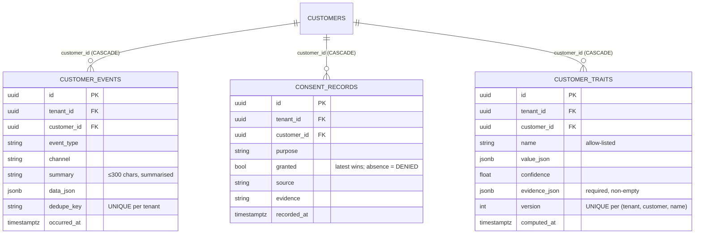

# ADR 0017: CRM memory — evidence-backed versioned traits, consent and erasure

- Status: **Proposed** (implementation exists but is uncommitted/unreviewed as of 2026-10-17)
- Date: 2026-10-17
- Phase: 8a (CRM memory)
- Relates to: AGENTS.md §10 (customer memory) and §12 (Kenya DPA), ADR 0012 (autonomy
  policy — customer-data deletion is always human-approved), CONSTITUTION.md §5
  (privacy/consent code is a protected zone).

## Context

Phase 8a gives SocialERP a customer database that "remembers history, preferences and
behaviour" (AGENTS.md §10). Customer facts are high-stakes: a wrong trait mis-sells, a
leaked one breaches the Kenya Data Protection Act, and an unexplainable trait cannot be
shown to a data subject. We need derived facts that are (a) explainable per row, (b)
refuse sensitive inference by construction, (c) consent-gated, (d) erasable on a lawful
request, and (e) computed deterministically — never by the LLM. The plan
(`docs/plans/2026-10-17-phase-8-crm.md`, Slice 8a) fixes the invariants; this ADR records
what the code (uncommitted) actually implements and where the two diverge.

## Decision

Seven invariants, enforced in code + DB:

1. **Trait allow-list as code.** `ALLOWED_TRAITS` in `packages/core/crm/service.py` is
   the closed set (`order_count`, `lifetime_value_cents`, `typical_order_hour`,
   `reorder_cycle_days`, `rfm_score`, `churn_risk`, `preferred_size`,
   `preferred_color`). `SENSITIVE_TRAIT_NAMES` (religion, ethnicity, health, sexual
   orientation, …) is refused explicitly as defence-in-depth. `record_trait` raises
   `TraitNotAllowedError` for anything not allow-listed; no API endpoint accepts a
   caller-supplied trait name, so a sensitive attribute cannot enter even via raw HTTP.

2. **Evidence + versioning.** Every stored trait carries a non-empty `evidence_json`
   (order ids, gap days, bucket inputs, candidate counts) and a monotonically
   increasing `version`; a recomputation **appends** a new version, prior versions are
   kept (`uq_customer_traits_version`). A trait with empty evidence is refused.
   `latest_traits` resolves the current view (highest version per name).

3. **Append-only event log with a DB backstop.** `customer_events` has no update/delete
   path in the service or repository, and migration `0012_crm.py` installs a trigger
   (`customer_events_no_mutate`) that rejects UPDATE/DELETE via raw SQL. Events are
   summarised (`summary` capped at 300 chars, structured `data_json`); raw message
   bodies are never stored wholesale (PII minimisation). Idempotency for at-least-once
   producers: unique `(tenant_id, dedupe_key)`, with a savepoint absorbing lost insert
   races.

4. **Erasure escape hatch gated by a GUC.** The trigger permits DELETE only when the
   transaction sets `app.allow_event_erasure = 'on'` (`set_config(..., is_local=true)`),
   which only `CRMService.delete_customer` does. The grant of DELETE on
   `customer_events` to `socialerp_app` is therefore safe: the trigger is the
   enforcement point, not the grant.

5. **Consent as first-class records.** `consent_records` stores (purpose, granted,
   source, evidence, recorded_at); **latest decision wins** per (customer, purpose) and
   **absence means DENIED** (`has_consent` defaults to false). `opt_out` appends a
   marketing denial. Marketing/win-back sends must gate on `has_consent(...,
   "marketing")` — a send without a granted record is a policy violation.

6. **Human-approved, audited erasure.** `delete_customer(..., approved_by=...)` requires
   an approver id (the API layer enforces `require_owner`); it sets the GUC, deletes
   events/traits/consents for the tenant+customer, **anonymises** the customer row
   (phone → tombstone `erased-<id>`, name/email/address NULLed, `is_active=false`) and
   scrubs the phone/name snapshot on the customer's orders. Order records themselves are
   **retained as the financial record** without personal identifiers. The action is
   written to the audit log with the acting user. This is an extension beyond the plan's
   "cascade for the CRM data" — scrubbing order snapshots is required for erasure to
   mean anything.

7. **Deterministic trait arithmetic.** RFM buckets, LTV (`Σ total_cents` over paid
   orders, reusing the ADR 0016 paid predicate), reorder cycle (median of order-date
   gaps) and churn risk (`days_since / expected_cycle`, clipped) are plain integer /
   statistics code. The LLM never computes or stores a trait.

All three tables carry `tenant_id` with RLS policy + `socialerp_app` grants mirroring
migrations 0002–0011; cross-tenant access fails closed (release blocker, tested).

## Alternatives considered

- **Traits computed by the LLM** — rejected: hallucinated customer facts are as
  dangerous as hallucinated prices (AGENTS.md §5 extends to customer memory); also
  unexplainable to a data subject.
- **Traits without evidence** — rejected: a bare `(name, value)` cannot be justified
  under a data-subject access request or debugged when a segment mis-fires.
- **Mutable event log** — rejected: loses the audit trail that consent, fraud flags and
  derived traits rest on; also makes export/erasure semantics incoherent.
- **Store raw message bodies** — rejected: PII minimisation (AGENTS.md §12); events
  summarise, and WhatsApp history sync is limited anyway (§3).

## Consequences

- **Positive:** every customer fact is explainable (evidence + version), sensitive
  inference is refused at two layers (allow-list + explicit refusal set), consent is
  default-deny, and erasure is an audited owner action — matching the Phase 8
  acceptance criteria.
- **Lawyer review flagged (Kenya DPA):** the consent model (purposes, lawful basis for
  non-marketing processing, withdrawal semantics) and the erasure flow (what "financial
  record retention" means under Kenyan tax/record-keeping law vs. the right to erasure)
  need review by a Kenyan data-protection lawyer before go-live. **Flagged, not
  resolved by this ADR.**
- **Open — trait staleness:** `derive_traits` is API-triggered only; there is no
  scheduled re-derivation and no staleness policy (when is a 3-month-old RFM stale?).
  Traits can silently go stale; a worker job + freshness policy is a follow-up.
- **Cost:** re-derivation loads all orders + items per customer; fine at pilot scale,
  will need batching per tenant at volume.
- **Divergence from plan (flagged Proposed/under review):** the plan says derivation
  draws from "the event log + orders"; the code derives **from orders only** — the
  event log is written and exportable but not yet a derivation input. The plan's
  "list/get customers" API endpoints are not implemented (only per-customer
  memory/events/traits/consent/derive/export/delete exist).

## References

- Plan: `docs/plans/2026-10-17-phase-8-crm.md` (Slice 8a, invariants 1–7).
- Code (uncommitted at time of writing): `packages/core/crm/service.py`,
  `packages/core/crm/repository.py`, `packages/core/models/crm.py`,
  `alembic/versions/0012_crm.py`, `apps/api/routes/crm.py`.
- Specs: AGENTS.md §10, §12; `docs/CONSTITUTION.md` §5 (privacy/consent protected zone).
- Uncertainty: no `docs/UNCERTAINTY.md` rows exist yet for Phase 8a (the plan lists
  UNCERTAINTY.md as a doc still to update); open items from this ADR — trait staleness
  policy, Kenya DPA lawyer review — should be filed there when the slice is committed.
