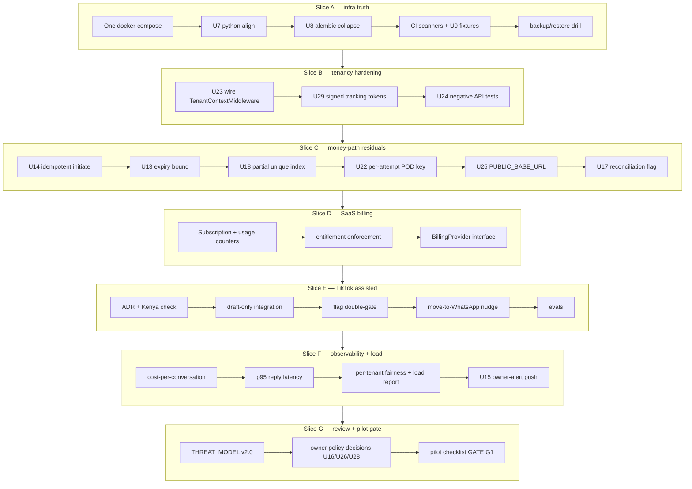

# PLAN: Phase 10 — TikTok assisted mode, SaaS billing, hardening/load/security review, pilot readiness

Date: 2026-10-18. Author: Chief Engineer (planning scribe). Status: PROPOSED — awaiting the
human's "go" (AGENTS.md §0 / parent program plan sequence: Phases 8 and 9 land first).

## Summary for a smart newcomer

Phase 10 is the last engineering phase before pilot (AGENTS.md §16). It does four things, in
this order of risk-reduction value: (1) it closes the open residual uncertainties listed in
`docs/UNCERTAINTY.md` (U7–U29) and reconciles the two disagreeing `docker-compose.yml` files;
(2) it adds our own SaaS billing — subscription plan flags + usage counters, strictly separate
from the tenant-facing M-Pesa payment machinery; (3) it adds TikTok in **assisted mode only**:
the agent drafts replies, the OWNER is always the sender, the whole channel is behind a feature
flag that defaults OFF because TikTok's Business Messaging API may not even be available in
Kenya; (4) it proves the system holds: load test against the §13 targets (100 tenants, 50
concurrent conversations/sec burst, p95 L1 reply < 5 s), a security review against
`docs/THREAT_MODEL.md` (which this phase UPDATES to v2.0), dependency/secret scanning in CI, a
backup/restore drill, and a signed pilot-readiness checklist (GATE G1).

## Treatment of the owner dashboard (per the parent program plan)

**The dashboard is a SEPARATE TRACK, not a Phase 10 slice.** The parent program plan
(`docs/plans/2026-10-15-program-phases-7-10-dashboard.md`, "Program sequence" item 6) sequences
the dashboard as API-aligned slices interleaved after Phase 7 APIs exist, and its acceptance
criteria live in its own section. Justification:

1. Different stack and gate: `apps/dashboard` is Next.js/TypeScript; `lint-js`/`typecheck-js`
   are NOT part of `make check` (STATE.md "Known Gaps") and `node_modules` is not even
   installed. Folding UI work into a phase whose gates are Python-only would either weaken the
   gate or block on toolchain work unrelated to Phase 10's risk profile.
2. Phase 10's deliverables are backend surfaces. TikTok assisted mode surfaces **API-level
   drafts** in the conversation inbox (the existing `WhatsAppMessageStatus.DRAFT` pattern from
   ADR 0014, generalized per channel); billing surfaces **API-level** plan/usage endpoints
   (`apps/api/routes/billing.py` — the router is already stubbed, commented out, in
   `apps/api/main.py:179`). The dashboard track consumes these APIs; nothing in this plan
   requires a UI merge.
3. The only dashboard work Phase 10 *requires* is what the dashboard track already owns: an
   inbox view that can display TikTok drafts with a "copy to send" affordance, and a billing
   settings page. Both are listed as **consumers** (interfaces frozen in this plan), not steps.

If the human wants the dashboard folded into Phase 10 anyway, the cheapest compromise is
one dashboard slice after Slice E: "TikTok draft inbox + billing page against the test DB",
with TypeScript type-check as its gate — but it is not on this plan's critical path.

## Goal and non-goals

**Goal** (AGENTS.md §16 Phase 10 AC): reach pilot readiness — TikTok assisted mode behind a
feature flag, SaaS billing as the only monetization, hardening/load/security review complete,
and a signed pilot-readiness checklist, with `make check` green at every commit.

**Non-goals**: live Stripe charges (sandbox/stub only; real charging needs a human-approved
design review — protected zone), real TikTok production credentials or direct TikTok sends
(assisted mode is draft-only by design), live Meta/Daraja credentials, customer data in dev,
dashboard UI work (separate track, justified above), non-Kenyan markets, U27 media ingestion
(deferred as a documented pilot limitation — see Slice G), U26 in-chat POD close via the
payments protected zone (needs its own ADR + human approval; default is dashboard-only closure).

Single-purpose test (AGENTS.md §1): every item here either (a) protects a sale (billing keeps
us solvent; TikTok drafts win sales the owner would otherwise miss; load-shedding protects
existing conversations), (b) saves the owner time (drafts, alerts), or (c) makes the business
safer/smarter (hardening, reconciliation, pilot gate). Nothing else is built.

## Classification (CONSTITUTION §1 principle 8)

- Type: mixed — feature delivery (TikTok, billing) + hardening/refactor (residuals, compose,
  tenancy wiring) + verification (load, security review, pilot gate).
- Risk: **HIGH** — touches protected zones by adjacency (billing is money-adjacent; tenancy
  middleware wiring is a release-blocker class; TikTok is a new external data ingress).
- Complexity: **HIGH** — seven slices, each independently shippable; no slice exceeds the
  complexity budget (one new domain module + one new integration package + infra/CI changes).

## Assumptions with confidence

(To be copied into `docs/UNCERTAINTY.md` by the scribe as new U-rows after human approval —
this session creates exactly one file.)

| # | Assumption | Confidence | How to verify / note |
|---|---|---|---|
| A1 | TikTok Business Messaging API is unavailable or unapproved for Kenya at build time, so assisted mode (draft-only, owner sends) is the correct and only legal design | 0.5 | Build-start step of Slice E: check official TikTok Business Messaging docs + apply for access; record evidence in this plan (TikTok has no ADR yet — ADR TBD). If Kenya IS available, the flag still defaults OFF and direct-send remains out of scope for Phase 10 |
| A2 | Phases 8 (CRM) and 9 (Instagram/onboarding) are implemented and committed before Phase 10 starts, per the parent program sequence | 0.9 | STATE.md "Current Phase" at start of work |
| A3 | Root `alembic/versions/` (0001–0012) is the complete system of record; `packages/core/alembic/alembic/versions/0001_initial.py` is a stale duplicate | 0.85 | Grep the repo for imports/references of `packages.core.alembic` before deleting; run the full suite against a migrated DB |
| A4 | Manual plan flags + usage counters are sufficient for the pilot; Stripe integration is an upgrade path, not a pilot blocker | 0.8 | Human confirm (open question 3). Stripe placeholders already exist (`packages/core/socialerp/settings.py:172-176`, `.env.example:125-129`) |
| A5 | Python target should be 3.13 (matches the measured local venv 3.13.15) with CI moved from 3.12 to 3.13 | 0.5 | Human confirm (open question 1; U7). Alternative: pin CI + local to 3.12 |
| A6 | The §13 load targets (100 tenants, 50 concurrent convos/s burst, p95 L1 reply < 5 s) are measurable on a single colima/Docker host with `ScriptedGateway` (no real LLM) | 0.6 | Slice F load harness; if the host is the bottleneck, run the harness against a larger host before drawing conclusions and record the host spec in the report |
| A7 | `FEATURE_TIKTOK_ENABLED` (env, `packages/core/config.py:92`) plus the per-tenant `feature_tiktok` flag (`packages/core/domain/tenant.py:55`) already exist and can serve as the double gate | 0.95 | Verified in tree 2026-10-18 |
| A8 | Owner alerts need only an interface + a durable sink for the pilot (console/outbox + log adapter); real SMS/WhatsApp push can be a post-pilot adapter | 0.7 | U15; human may prioritize a real channel |

## Derivation: first principles and invariants

**Why assisted mode for TikTok.** AGENTS.md §3 fixes the constraints: official API only,
reply-only, short reply window with a message cap, regional availability may exclude Kenya,
and the spec's own answer — "TREAT TIKTOK AS PHASE 5 AND BEHIND A FEATURE FLAG... implement
'assisted mode': the agent drafts replies for the owner to send, and moves the customer to
WhatsApp as soon as they engage." From first principles: a channel the system can receive on
but never send on has a strictly smaller attack surface (no stored TikTok send credentials, no
blast radius for agent-generated outbound, no marketing-window violations by us) while still
winning the sale (the owner sends the drafted reply from their own TikTok app within the
window). The invariant follows mechanically:

- **I1 (draft-only TikTok)**: no code path in `packages/integrations/tiktok/` performs an
  outbound HTTP send. Enforced by a test that imports the package and asserts the sender
  implementation has no network client, plus a dependency-rule test that the package does not
  import `httpx`/`aiohttp` at send time (the webhook receiver still needs an HTTP *server*,
  which FastAPI already provides).
- **I2 (double-gated flag)**: TikTok processing requires BOTH the global env flag
  `FEATURE_TIKTOK_ENABLED=True` AND the tenant's `feature_tiktok=True`. Default OFF at both
  layers. Webhook receiver rejects/ignores when either is off (fail closed, 202-reject not
  500, with an audit line).
- **I3 (owner is the sender)**: every TikTok outbound artifact is a `DRAFT` (reusing the ADR
  0014 draft pattern). The "move to WhatsApp" nudge is itself a draft; the agent never sends
  it.

**Why manual billing first.** Our monetization is the SaaS subscription (AGENTS.md §4.12
billing service), strictly separate from tenant customer payments. First principles: the
pilot needs (a) a record of what plan each tenant is on, (b) usage numbers to price and to
operate (cost-per-conversation is also an §13 metric), and (c) a way to stop a cancelled
tenant from consuming LLM spend — none of which requires a payment processor. A `BillingProvider`
interface (mirroring the `PaymentProvider` pattern in `packages/integrations/provider_resolver.py`)
lets Stripe slot in later without touching entitlement logic. Invariants:

- **I4 (no co-mingling)**: `packages/core/billing/` never imports `packages.core.payments` or
  `packages.integrations.*` payment providers; billing tables carry our SaaS plan/amount
  fields only (no M-Pesa references); customer-payment tables carry no plan fields.
  Enforced by a dependency-rule test.
- **I5 (fail-safe degradation, never data hostage)**: a cancelled/past-grace tenant is
  degraded (agent drops to L0 shadow drafts + holding replies; premium API endpoints 402),
  never deleted, and inbound customer messages are always accepted and logged (a holding
  reply protects the sale). Entitlement is re-checked at every agent run and API request —
  never cached longer than one request/job.
- **I6 (usage is observed, not asserted)**: usage counters are incremented from the same
  events the audit log records (agent runs, gateway `cost_usd` which already exists on
  `LLMResponse` in `packages/agent/gateway.py`); a daily job reconciles counters against the
  audit trail and alerts on drift.

**Why tenancy middleware now.** RLS is currently inert on the API path (U23): the policies
exist in migrations 0003–0012 but `TenantContextMiddleware`/`DatabaseSessionMiddleware`
(`packages/core/middleware/tenant_context.py`) are not registered in `apps/api/main.py`.
Invariant:

- **I7 (RLS on by default, public paths by explicit allow-list)**: every authenticated API
  request runs with `SET LOCAL app.current_tenant_id` set; the public tracking endpoints are
  the ONLY allow-listed tenant-less path, and they get signed, expiring tokens (U29) so the
  capability-URL design becomes fail-closed. Webhook paths stay excluded (authenticated by
  signature instead — S-01/S-02 in the threat model).

**Why per-tenant fairness in the worker.** §13 targets 100 tenants with burst; the outbox
relay (`apps/worker/main.py`) currently processes events FIFO with no per-tenant bound, so one
noisy tenant can starve everyone (incentive: a tenant's botched integration becomes everyone's
p95 problem). Invariant:

- **I8 (fair share)**: the relay caps concurrent agent runs per tenant (token bucket /
  semaphore) and gives provider webhooks (payment callbacks, inbound messages) priority over
  cron/best-effort jobs. Payment callbacks are NEVER shed — shedding is only applied to
  agent-draft work, and shedding produces a durable owner alert, not a silent drop.

**Program-level invariants carried forward** (parent plan, conservation laws): the LLM never
does money/stock/delivery arithmetic; every tenant table has RLS + cross-tenant tests fail
closed; idempotency everywhere; `make check` green with real output; evals wrong-price/stock
rate stays 0.

## Options per major decision

### D1. TikTok assisted-mode architecture

- **Option A (chosen): full channel skeleton, draft-only sender.** New package
  `packages/integrations/tiktok/` (`webhook.py` receiver with signature verification,
  `window_tracker.py` for the short reply window + message cap, `sender.py` implementing the
  existing `MessageSender` protocol from `packages/conversation/agent_service.py` but ONLY
  ever persisting `DRAFT` rows). Inbound flows through the existing outbox
  `inbound_message:{provider_message_id}` idempotency key (ADR 0014) into
  `ConversationAgentService`, which already persists drafts at L0. Why: maximum reuse of the
  proven WhatsApp/Instagram pipeline (dedupe, window, drafts, handoff), smallest new code,
  and the draft-only invariant is testable in isolation.
- **Option B: minimal inbox-only integration (no webhook).** Owner pastes/copies TikTok
  messages into the dashboard; agent drafts in the inbox. Rejected: loses the inbound
  automation that makes response under 30 s possible; contradicts "official API only,
  receive-capable" design; more owner work, not less.
- **Option C: direct-send TikTok integration now (if Kenya is available).** Rejected: AGENTS
  §3 explicitly gates direct sends; A1 confidence is 0.5; send-side abuse blast radius is the
  owner's TikTok account. Can be revisited post-pilot as a flag-gated upgrade behind the same
  `BillingProvider`-style provider interface.

### D2. Billing baseline

- **Option A (chosen): manual plan flags + usage counters + `BillingProvider` interface.**
  Migration `0013_billing`: `subscriptions` (tenant_id unique, plan enum
  starter/professional/enterprise/trial, status active/past_due/cancelled, period end, audit
  columns, RLS) and `usage_counters` (tenant_id, metric, period, integer value, RLS).
  `packages/core/billing/` service with `check_entitlement`, `record_usage`,
  `apply_plan_change` (human/owner-console action, audited), `handle_provider_event` (no-op
  provider). Existing tenants are backfilled to `trial/active` by the migration so pilot
  tenants are never bricked (derivation: fail-safe default = entitlement ON until a human
  says otherwise; abuse is bounded by spend caps).
- **Option B: Stripe subscriptions from day one.** Rejected for the pilot: needs real keys,
  human-approved charge design (protected zone), and webhook-forgery hardening before a
  single pilot tenant exists. Kept as the documented upgrade path (Option A's interface is
  designed for it; the stubbed `apps/api/routes/billing.py` router and settings placeholders
  already anticipate it).
- **Option C: invoice/ops-managed billing outside the system (spreadsheet).** Rejected: no
  entitlement enforcement, no cost-per-conversation, contradicts AGENTS §4.12 and the
  program plan ("implement billing service").

### D3. Entitlement enforcement point for cancelled tenants

- **Option A (chosen): degrade at the agent boundary.** `handle_inbound_message` in
  `apps/worker/main.py` checks entitlement before constructing the agent: not entitled →
  persist the inbound, send/log a holding reply (template, no LLM), set handoff, audit
  `billing.entitlement_denied`. API: premium endpoints return 402 with a clear message.
  Protects LLM spend (the expensive resource) while never dropping a customer message.
- **Option B: hard block at the webhook.** Rejected: drops customer messages (loses sales,
  violates I5, and a blocked customer blames the business, not us).
- **Option C: block only the dashboard.** Rejected: worker LLM spend continues; the abuse we
  care about (cancel-but-keep-using) is precisely the worker path.

### D4. RLS wiring style (U23)

- **Option A (chosen): slim auth middleware + per-request `SET LOCAL` in the session
  dependency.** Register a slimmed `TenantContextMiddleware` (JWT → `request.state`) in
  `apps/api/main.py`; make the FastAPI session dependency execute
  `SELECT set_config('app.current_tenant_id', $1, true)` with a **validated UUID** (the
  current `DatabaseSessionMiddleware` uses an f-string — unacceptable; parameterize it).
  Public tracking paths go through an allow-listed session with no tenant var + signed tokens
  (U29). Why: works with FastAPI's DI (routes already use `get_session`), keeps `SET LOCAL`
  transaction-scoped, avoids the middleware owning DB sessions.
- **Option B: wire both existing middlewares as written.** Rejected: the f-string
  `SET LOCAL`, the middleware-owned session, and the interaction with existing route-level
  `Depends(get_session)` would double-open sessions and fight the DI model.
- **Option C: leave RLS inert, rely on explicit tenant_id scoping in services.** Rejected:
  STATE.md and the constitution name this a release-blocker class; U29 already shows how
  explicit scoping gets missed.

### D5. Load-shedding / fairness mechanism

- **Option A (chosen): per-tenant concurrency cap in the outbox relay + priority classes.**
  Relay reads tenant_id from the event, takes a per-tenant semaphore before dispatching
  agent-run handlers, and processes priority classes in order: payment/provider events >
  inbound agent runs > crons. Cap value is a setting (`WORKER_PER_TENANT_CONCURRENCY`,
  default derived from §13: 50 concurrent / 100 tenants ≈ 1, headroom 2).
- **Option B: one queue per tenant.** Rejected: operationally heavy (100 queues), arq is
  Redis-single-queue oriented; over-engineering for the pilot.
- **Option C: global queue, no fairness (status quo).** Rejected: fails the incentive review
  (noisy tenant starves quiet tenants) and the §13 burst target.

### D6. U29 signed tracking tokens

- **Option A (chosen): signed, expiring tracking token.** `GET /api/v1/tracking/{order_id}?t=<token>`
  where the token is HMAC over `order_id|tenant_id|exp` using `APP_SECRET_KEY` (via
  `packages/core/security/verify_hmac_sha256` primitives), issued when the order confirmation
  message is generated, TTL configurable (default 14 days — derivation: typical Nairobi
  delivery window plus reorder-check slack). Cross-tenant test: a token for tenant A's order
  presented on any path cannot reveal tenant B data; a foreign order UUID without a valid
  token 404s.
- **Option B: `SECURITY DEFINER` SQL function returning minimal fields.** Rejected: keeps
  the unguessable-UUID capability-URL model, moves the blast radius into SQL where review is
  harder; can be added later as defense-in-depth.
- **Option C: put tracking behind login.** Rejected: customers (no accounts) are the
  consumers; contradicts SPEC §9.

### D7. Python version (U7)

- **Option A (chosen, pending human confirm): align everything to 3.13.** `requires-python =
  ">=3.13"`, mypy `python_version = "3.13"`, CI `PYTHON_VERSION: "3.13"`. Why: the measured
  venv is 3.13.15; local reality should lead.
- **Option B: pin local + CI to 3.12.** Valid alternative; costs a venv rebuild.
- **Option C: leave as-is (pyproject >=3.12, mypy 3.13, CI 3.12).** Rejected: three-way
  drift is exactly the class of "silent disagreement" the settings-identity hazard taught us
  (STATE.md).

## Steps: ordered small commits, tests first

Each step is one commit: tests (failing) → minimal code → `make check` green → docs touch.
Protected zones (payments service, refunds, consent/permission code, evals, CI gates) get
human-approved diffs only; steps that touch them are marked ⚠.

### Slice A — infrastructure truth (U7, U8, U9 + compose + CI)

1. **A1. Reconcile docker-compose.** Decide canonical = root `docker-compose.yml` (it matches
   CI ports 8081/8082, the real Dockerfile paths `packages/integrations/fake_meta/Dockerfile`
   and `fake_daraja/Dockerfile`, and has the `test`/`fake`/`app` profiles). Merge anything
   unique from `infra/docker-compose.yml` (the `infra/sql/init-rls.sql` +
   `init-test-db.sql` mounts) into `infra/postgres/init.sql`, delete
   `infra/docker-compose.yml`, and verify `docker compose --profile all config` validates.
   Tests: a contract test (or CI step) that runs `docker compose config` and greps that no
   second compose file exists; document `docker compose up` as the supported path in
   STATE/README. Rollback: `git revert`; no DB impact.
2. **A2. Python alignment (U7).** Per D7-Option A (pending confirm): update root
   `pyproject.toml`, `packages/core/pyproject.toml`, `.github/workflows/ci.yml`. Test: CI
   green on 3.13; local `make check` unchanged.
3. **A3. Collapse the duplicate Alembic tree (U8).** Verify A3 (grep for
   `packages.core.alembic` references), delete `packages/core/alembic/` and
   `packages/core/alembic.ini`, and add a guard test asserting exactly one
   `alembic/versions` directory exists in the repo. Test: guard test + full suite against a
   freshly migrated DB (`make migrate` from root).
4. **A4. Sandbox webhook recordings (U9).** Record real Meta/Daraja sandbox webhook payloads
   (human runs against sandboxes once; payloads sanitized of secrets) into
   `tests/fixtures/meta/` and `tests/fixtures/daraja/`; add contract tests replaying them
   through the fake servers (`packages/integrations/fake_meta`, `fake_daraja`) and the real
   receivers (`packages/integrations/meta/webhook.py`, Daraja callback route). Test: replay
   contract tests.
5. **A5. CI scanners.** ⚠ (CI gate definitions are a protected zone — human approves the
   diff.) Add jobs: `pip-audit` (or `uv audit`) over the lockfile, `gitleaks` secret
   scanning, and fix the ci.yml toolchain drift (it currently uses `pip install -e
   ".[dev,test]"` + `make lint` which also runs `lint-js` with no node_modules — make the
   Python check job use `uv` + `make check`'s Python targets so CI actually reflects the
   measured local gate). Tests: a deliberately planted fake secret in a throwaway branch must
   fail gitleaks (verified once, not committed); audit job fails on a known-vulnerable
   fixture.
6. **A6. Backup/restore drill.** Script `infra/backup_restore_drill.sh`: `pg_dump` → restore
   into a scratch DB → assert row counts + `pg_policies` shows RLS enabled on every tenant
   table (query `pg_class`/`pg_policies`) → record timing. Runbook
   `docs/RUNBOOKS/backup-restore.md`. Test: the script is idempotent and exits non-zero on a
   seeded mismatch.

### Slice B — tenancy hardening (U23, U29, U24)

7. **B1. Wire tenant context (U23).** Implement D4-Option A: slim middleware registered in
   `apps/api/main.py`; session dependency sets `SET LOCAL app.current_tenant_id` via
   parameterized `set_config`; webhook routes and the tracking allow-list excluded (see B2).
   Tests first: an API-path cross-tenant test that currently FAILS (tenant B's JWT reading
   tenant A's order via a service that forgot tenant_id) then passes; RLS tests promoted from
   `tests/tenancy/test_rls.py` to run against the real app dependency, not a stubbed
   `get_current_tenant_id`.
8. **B2. Signed tracking tokens (U29).** D6-Option A. Token issue on order confirmation
   (worker handler for `order.created`); tracking routes require a valid token; old
   capability-URL behavior 404s. Tests: foreign UUID without token → 404; expired token →
   404; tampered token → 404; valid token → 200 with the existing no-PII assertions intact.
9. **B3. Remaining negative API tests (U24).** Bad/duplicate path UUIDs → 422; unauthenticated
   → 401 across delivery/zone/rider/dispatch/CRUD routes; document the status-code contract
   in each route's docstring. Tests: parametrized negative suite.

### Slice C — money-path residuals (U13, U14, U18, U22, U25, U17) ⚠ payments protected zone

10. **C1. Idempotent initiate replay (U14).** In `PaymentService.initiate_stk_payment`
    (`packages/core/payments/service.py`): catch `IntegrityError` on the idempotency-key
    insert, rollback, re-read the existing payment, return it (idempotent replay). Tests:
    two concurrent initiates with the same key → both get the SAME payment id, HTTP 200, one
    provider call (barriered fake provider, mirroring the U19 test technique).
11. **C2. Deferred-cancel expiry bound (U13).** New deterministic rule: if an order is
    `awaiting_payment` with `payment_status == failed` and NO payment attempt is
    INITIATED/PENDING, auto-cancel after a bounded window (setting
    `PAYMENT_EXPIRY_MINUTES`, default 30 — derivation: STK Push timeout is minutes, not
    hours; 30 min covers late callbacks with the status-query backstop already in
    `reconciliation.py`). Emits `owner_alerts` (reuse `packages/core/alerts/`) so the owner
    sees the cancellation. ⚠ owner-visible rule — human approves the default. Tests: the
    exact U13 sequence (A deferred, B fails → order auto-cancels and reservation releases);
    a late success callback AFTER auto-cancel hits the existing collect-after-terminal guard
    (U15 path), never a silent loss.
13. **C3. Single-completion DB backstop (U18).** Migration `0014_delivery_single_completion`:
    `CREATE UNIQUE INDEX ... ON deliveries(order_id) WHERE status = 'completed'`. ⚠ (a
    migration in the payments-adjacent zone; dry-run + symmetric downgrade per CONSTITUTION
    §3 principle 4). Tests: true concurrent double-complete (two sessions, barrier) → one
    wins, one gets the constraint error mapped to an idempotent result/409, never double SELL.
14. **C4. Per-attempt POD idempotency key (U22).** Include an attempt counter in the arrived
    key: `delivery:{id}:arrived:a{n}` where n = retry attempt from `retry_after_failure`.
    Tests: failed attempt → retry → second arrival produces a NEW prompt; in-flight first
    attempt still dedupes replays.
15. **C5. Shared callback-URL builder (U25).** New setting `PUBLIC_BASE_URL`; one builder in
    `packages/core/payments/` used by both the API arrival route and the worker
    `trigger_pod_collection`; `DARAJA_CALLBACK_URL` wins if set; worker logs a CRITICAL
    `owner_alerts` row (not a silent warning) if neither is configured in production. Tests:
    worker path with only `PUBLIC_BASE_URL` produces the same callback URL as the API path.
16. **C6. Captured-without-SELL reconciliation (U17).** Extend
    `packages/core/payments/reconciliation.py::reconcile_tenant` to flag COMPLETED payments
    whose order has no matching SELL movement (`collected_after_terminal` metadata and the
    U16 blocked-delivery case). Outputs an owner alert + a row in the reconciliation report
    (runbook `docs/RUNBOOKS/reconciliation.md` gains the section). Tests: seeded mismatch is
    flagged; a healthy order is not.

### Slice D — SaaS billing (D2/D3)

17. **D1. Billing domain + migration.** `0013_billing`: `subscriptions`, `usage_counters`
    (RLS + grants, backfill existing tenants to `trial`). `packages/core/billing/models`
    (SQLAlchemy, following `packages/core/models/alert.py`), domain enums, and
    `BillingService` with `check_entitlement` / `record_usage` / `apply_plan_change`
    (audited via `packages/core/audit`). Dependency-rule test: `packages.core.billing` does
    not import `packages.core.payments` (I4). Tests: entitlement matrix per plan × feature
    (e.g. L2 transact requires >= professional — plan table is a named constant with stated
    derivation, not a magic number); backfill correctness; RLS cross-tenant tests (mirror
    `tests/alerts/test_alerts_rls.py`).
18. **D2. Entitlement enforcement.** Wire `check_entitlement` into
    `apps/worker/main.py::handle_inbound_message` (Option A: degrade to holding reply +
    handoff + audit `billing.entitlement_denied`) and into the API layer for premium routes
    (402). Usage recording: increment `usage_counters` from the same handler (conversations
    metric) and from the gateway response `cost_usd` (llm_spend metric — the number already
    computed in `packages/agent/gateway.py`). Tests: cancelled-tenant conversation → holding
    reply, zero LLM calls (ScriptedGateway call list empty), handoff set, audit row present;
    entitled tenant unaffected; counter increments exactly once per conversation under
    webhook replay (idempotency thread-through from ADR 0014).
19. **D3. Billing API.** `apps/api/routes/billing.py` (uncomment the router in
    `apps/api/main.py`): `GET /api/v1/billing/subscription`, `GET /api/v1/billing/usage`,
    `POST /api/v1/billing/subscription` (owner-only, plan change, audited), and a stubbed
    `POST /api/v1/billing/webhook` for Stripe events behind `STRIPE_WEBHOOK_SECRET` with
    HMAC verification (`packages/core/security/verify_hmac_sha256`) — signature-checked,
    idempotent (dedupe by event id), and with NO effect when no Stripe keys are configured.
    ⚠ human reviews the webhook handler before any real key exists. Tests: forged signature
    → 401; replayed event → one effect; plan change audited and visible to entitlement.
20. **D4. `BillingProvider` interface + Manual provider.**
    `packages/core/billing/provider.py` (Protocol) + `NoopBillingProvider` /
    `ManualBillingProvider` (human sets plans; provider events none). Mirrors the
    `PaymentProvider` pattern; the future Stripe provider lands in
    `packages/integrations/stripe/` without touching the service. Tests: provider protocol
    conformance suite (shared test base, like the payment providers have).

### Slice E — TikTok assisted mode (D1)

21. **E1. TikTok ADR (TBD) + Kenya availability check.** Human/agent checks official TikTok Business
    Messaging API docs for Kenya availability and access requirements; the answer (with
    links/evidence) is recorded in `docs/adr/XXXX-tiktok-assisted-mode.md` and the A1
    uncertainty row is updated by the scribe. No code. This is a hard gate for E2+.
22. **E2. TikTok integration package.**
    `packages/integrations/tiktok/`: `webhook.py` (receiver; signature verification per the
    official scheme verified in E1; dedupe by provider message id into the outbox
    `inbound_message:{provider_message_id}` event with `channel=tiktok` — the channel enum
    value already exists in `packages/core/domain/__init__.py:405`),
    `window_tracker.py` (short reply window + message cap per AGENTS §3, modeled on
    `packages/integrations/meta/window_tracker.py`),
    `sender.py` (`MessageSender` implementation that ONLY persists `DRAFT` — I1),
    `__init__.py` factory gated by D8's double flag (I2). Tests: signature valid/invalid/
    missing; duplicate webhook deduped; flag-off (either layer) → inbound ignored + audit;
    sender test asserting no outbound network call is possible (I1 — the draft sender's
    interface has no "send" method that touches HTTP); window/cap logic unit tests.
23. **E3. Pipeline + inbox surfacing.** `handle_inbound_message` already routes by channel;
    add the tiktok case (draft persistence status, conversation row gets channel metadata).
    API: `GET /api/v1/conversations?channel=tiktok` (list filter) + draft messages returned
    with a `copy_to_send` affordance field (JSON only — dashboard track consumes it). Tests:
    tiktok inbound → draft in inbox, zero sends, handoff flag if policy escalates; cross-
    tenant draft visibility fails closed.
24. **E4. Move-to-WhatsApp nudge.** Policy rule: when a tiktok conversation reaches
    engagement (customer sent ≥ 2 messages OR owner taps "suggest WhatsApp"), the agent
    drafts (never sends) a nudge containing the tenant's configured WhatsApp link
    (tenant settings `whatsapp_link`), gated by the policy engine (I3) and rate-limited to
    once per conversation. Template lives in `packages/agent/` prompt assets; the nudge text
    is grounded on tenant config, not model invention. Tests: trigger threshold; no duplicate
    nudge; nudge is DRAFT; injection cannot trigger nudge to a third party.
25. **E5. Evals.** New labeled set `evals/conversation_sets/tiktok_assisted/` (draft-only
    assertions, English/Swahili/Sheng cases, injection cases, "customer asks to order" →
    draft + WhatsApp-move suggestion, never a fabricated price). Promote to active in
    `evals/runner.py`. Wrong-price/stock rate must stay 0.

### Slice F — observability, load, fairness (§13 + U15)

26. **F1. Cost-per-conversation.** The agent already audits `agent.message_handled`
    (`packages/conversation/agent_service.py`) and the gateway computes `cost_usd`; add the
    per-run cost to the audit metadata and a daily aggregation job writing
    `usage_counters(metric="conversations"|"llm_spend")` — the same counters as D2, so
    billing and §13 share one source of truth (derivation: one metric, two consumers; drift
    is a bug, checked by C/D reconciliation). Metric emitted via OpenTelemetry
    (`packages/core/observability`): `llm_cost_usd_total{tenant_id}`,
    `conversations_total{tenant_id}`. Tests: aggregation job math; metric emission.
27. **F2. p95 reply latency.** Span/metric: webhook-received → outbound-persisted per
    message (timestamps already exist on message rows; add a monotonic measure in the
    worker handler). Histogram metric `agent_reply_latency_seconds{tenant}`; alert rule
    documented. Tests: metric recorded with the right name/labels (observability test
    mirroring `tests/observability/test_tracing.py`).
28. **F3. Fairness + load harness (D5).** Relay change: per-tenant semaphore
    (`WORKER_PER_TENANT_CONCURRENCY`, default 2) + priority ordering (provider events >
    inbound > crons) — ⚠ touches the worker money-adjacent relay; human reviews. Load
    harness `scripts/load_test.py` (async httpx + fake Meta + ScriptedGateway, seed 100
    tenants × conversations via factories): scenarios = steady 10 msg/s, burst 50 concurrent
    conversations, noisy-tenant flood. Report: p50/p95/p99 reply latency, queue depth, error
    rate, per-tenant fairness (quiet tenant p95 under flood). Tests: fairness unit test
    (barrier: noisy tenant saturated → quiet tenant's event still completes within bound);
    payment-callback priority test (callback not delayed behind 100 agent runs).
29. **F4. Owner-alert push (U15).** `packages/core/alerts/notifier.py`: `AlertNotifier`
    protocol; pilot adapter = outbox event + log + surfaced on `GET /api/v1/alerts` (already
    exists) + owner-console message via the existing conversation pipeline (Phase 8
    dependency, A2). A real SMS/WhatsApp adapter is post-pilot (A8). Tests: alert row
    creation triggers exactly one notifier call; notifier crash does not fail the alert
    (alert is durable first, I5-style).

### Slice G — security review, threat model v2.0, pilot gate

30. **G1. THREAT_MODEL.md update to v2.0.** New/changed entries: Stripe webhook forgery
    (S-02 extension: HMAC + event-id dedupe + no-effect-without-keys), TikTok channel
    (new row: forged TikTok webhook; draft-only reduces outbound risks — note the residual:
    owner-sent content is the owner's responsibility), signed tracking tokens (I-01
    extension), billing entitlement bypass (E-06: cancel-but-keep-using → per-run
    entitlement check + audit), load-shedding fairness (D-07: noisy-tenant starvation →
    per-tenant caps), `SET LOCAL` injection (T-07: parameterized set_config). Update the
    Kenya DPA table (TikTok drafts store customer messages → covered by CRM retention),
    mark P0/P1 checklist items with evidence links (test names), set Next Review = before
    pilot launch. Review by skeptic + human. ⚠ security doc, human signs.
31. **G2. Owner policy decisions (U16/U17/U26/U28 + C2 default).** A short decision session
    with the human, results recorded as ADR 0018 (billing/POD policy) and UNCERTAINTY
    updates: (i) confirm the U16 fail-safe (block delivery on captured-not-collectable) or
    switch to auto-honour; (ii) who reconciles captured-without-SELL (runbook owner);
    (iii) U26: confirm dashboard-only POD closure for pilot (no payments-zone change);
    (iv) U28: accept the bare-"done" residual or drop it (one-line change, tests);
    (v) confirm C2's 30-minute expiry default. No code unless a decision says otherwise.
32. **G3. Pilot-readiness checklist (GATE G1).** `docs/RUNBOOKS/pilot-readiness.md`: every
    AGENTS §16 Phase 10 AC line, every THREAT_MODEL P0 item, all U-rows resolved or
    explicitly accepted-by-owner, load report attached, `make check` real output attached,
    backup drill executed, feature-flag inventory (all default states listed), onboarding
    dry-run (Phase 9 AC) re-verified. Sign-off: human + skeptic. This doc is the gate; pilot
    does not start without it.
33. **G4. Final verification.** Full `make check` (ruff + mypy --strict + pytest + evals)
    with real output pasted into STATE.md; load report archived; scribe updates STATE/MAP/
    UNCERTAINTY/GLOSSARY (new terms: assisted mode, entitlement, grace, fair-share).

## Blast radius and rollback

| Slice | Blast radius | Rollback |
|---|---|---|
| A (infra/CI) | Local dev + CI only; compose file deletion affects `docker compose` users | `git revert`; containers re-create from volumes (data persists) |
| B (tenancy wiring) | ALL authenticated API requests gain RLS context — highest regression surface of the phase | Feature-flag the middleware registration (`TENANCY_MIDDLEWARE_ENABLED`, default ON after bake-in, OFF emergency switch); revert commit |
| C (money paths) | Payment initiate/cancel/complete + delivery completion | Migrations have symmetric downgrades; each guard is additive; revert per-commit; fake-provider tests prove behavior before deploy |
| D (billing) | New tables + worker/API gates; default backfill = entitled, so existing behavior unchanged until a human flips a plan | Entitlement checks read current row: flip plan back = instant; migration downgrade drops new tables only |
| E (TikTok) | None beyond flagged tenants (flag default OFF, double-gated) | Flag off = channel inert; no data migration to undo |
| F (relay fairness) | Worker throughput behavior for all tenants | Concurrency cap setting → raise/disable; priority ordering revertible independently |
| G (docs/gates) | Docs + process | Docs revert; gate failure blocks pilot (that's its job) |

Deploy order if staged: A → B → C → D → E → F → G. Every slice ends with `make check` green
(CONSTITUTION §7); no slice ships two concerns.

## Incentive review (CONSTITUTION §1 principle 6)

- **TikTok spam / abuse.** (a) *Malicious external party floods a tenant's TikTok inbox* →
  drafts cost us LLM tokens; bounded by per-tenant spend caps (`SpendCapGateway`,
  `LLM_PER_TENANT_DAILY_CAP_USD`), the new per-tenant relay cap (F3), and the TikTok window
  message cap. (b) *Tenant weaponizes drafts to spam customers* → we never send; the owner
  is the sender on their own TikTok account — platform enforcement lands where the sender
  is; our audit log still records every draft. (c) *Agent drafts a "move to WhatsApp" nudge
  to harvest customers for another business* → nudge text is grounded on the tenant's own
  settings, rate-limited per conversation, and owner-sent.
- **Billing fraud — tenant cancels but keeps using.** Entitlement is re-checked at every
  agent run and premium request (never long-cached); denial is audited
  (`billing.entitlement_denied`) and visible in usage reports; degradation keeps inbound
  messages (protecting the *tenant's* customers, which is also our reputation) but spends
  zero LLM money. *Trial abuse (many free tenants, one human)* → signup is phone-verified
  (existing auth); mass-signup detection is a post-pilot insight, noted in the checklist.
  *Chargebacks* (future Stripe): out of scope for pilot; human-approved refund posture
  mirrors the payments zone.
- **Load-shedding fairness.** A tenant who floods the queue pays in their own degraded
  latency (their cap), not others'; quiet tenants' p95 is protected (F3 fairness test is an
  AC). Payment callbacks are never shed and are signature-gated, so a tenant cannot mint
  priority traffic. Crons yield to live traffic.
- **Meta/Safaricom/TikTok/regulator.** TikTok assisted mode stores customer messages →
  retention/consent inherited from CRM (Phase 8); Kenya DPA items stay flagged for the
  lawyer (ODPC registration is a G3 checklist line, not code). Competitors: nothing here
  exposes tenant data.

## Failure modes and how each is detected

| Failure | Detection |
|---|---|
| TikTok webhook forgery | Signature verification (E2 tests); rejected-count metric; audit line |
| Feature flag bypass (code path runs while flag off) | Flag-check tests at BOTH gates (webhook + worker); code review gate: no tiktok import outside the gated factory |
| Draft accidentally sent (I1 violated) | Sender-has-no-network test; dependency-rule test; load report must show zero tiktok outbound calls |
| Entitlement check stale/cached → cancelled tenant keeps LLM spend | Per-run check design; test with ScriptedGateway call list; audit query for denials vs gateway calls |
| Usage counter drift vs audit | Daily reconciliation (F1 job) alerts on mismatch |
| `SET LOCAL` injection via forged JWT claim | Parameterized `set_config` + UUID validation test; middleware rejects non-UUID tenant claims |
| Tracking token leak/replay | HMAC + expiry; tampered/expired tests; tokens are per-order, revocable by order deletion |
| Deferred-cancel expiry cancels an order with money in flight (C2 regression) | The C2 test is exactly the U13 sequence; the paid-guard (2026-10-16 hardening) still runs first; collect-after-terminal backstop (U15) catches late success |
| Load test false pass (host-bound, not app-bound) | Record host spec; run burst against docker-compose profile `all` (closest to prod topology); report includes queue-depth time series so app-side stalls are visible |
| Compose reconciliation breaks local dev | `docker compose --profile all up` smoke in CI docker-build job; `make db-up` re-verified |
| Self-weakening under schedule pressure | STOP protocol (CONSTITUTION §4); protected-zone diffs human-approved; skeptic signs each slice |

## Acceptance criteria (measurable — GATE G1 inputs)

1. `make check` (ruff + mypy --strict + pytest + evals) exits 0 at every commit; final real
   output recorded in STATE.md. Evals wrong-price/stock rate = 0, including the new
   `tiktok_assisted` capability (≥ 6 labeled cases active, not deferred).
2. **TikTok**: `FEATURE_TIKTOK_ENABLED` default False in `.env.example`, config, and
   settings; flag-off tests green at both gates; draft-only invariant test green (zero
   outbound HTTP possible); nudge drafts only, ≤ 1 per conversation; TikTok ADR (TBD) exists with
   the Kenya evidence recorded.
3. **Billing**: subscription + usage tables migrated with RLS and cross-tenant tests;
   backfill leaves existing tenants entitled; a cancelled-past-grace tenant's inbound
   conversation yields holding reply + handoff + audit, with ScriptedGateway call count = 0;
   dependency test billing↛payments green; `POST /api/v1/billing/webhook` rejects forged
   signatures and dedupes replays; NO real Stripe charge possible with the pilot config
   (no keys; handler no-ops without keys).
4. **Hardening**: exactly ONE alembic tree (guard test); ONE docker-compose file
   (`docker compose --profile all config` validates in CI); CI runs dependency audit +
   secret scanning; U7, U8, U9, U13, U14, U15(pilot adapter), U17(flag + runbook), U18,
   U22, U23, U24, U25, U29 rows marked RESOLVED in UNCERTAINTY.md with test names; U16,
   U26, U28 recorded as owner-accepted decisions (ADR 0018); U27 recorded as an accepted
   pilot limitation.
5. **Load** (report attached): 100 tenants seeded; sustained 50 concurrent conversations
   without error-rate > 1%; p95 webhook→draft-persist latency < 5 s under burst (measured,
   host spec noted); noisy-tenant flood does not push a quiet tenant's p95 above the same
   bound; payment-callback latency unaffected by agent-load flood.
6. **Security**: THREAT_MODEL.md v2.0 published with the new rows and P0 evidence links;
   backup/restore drill script green; skeptic sign-off recorded; pilot-readiness checklist
   fully checked and signed by the human.

## Docs to update (during implementation, by the scribe)

- `docs/UNCERTAINTY.md`: copy A1–A8 as new rows; flip the U-rows listed in AC 4 with test
  evidence; new rows for any residual found during the phase.
- `docs/adr/XXXX-tiktok-assisted-mode.md` (D1 + I1/I2/I3 + Kenya evidence);
  `docs/adr/YYYY-billing-entitlement-and-pod-policy.md` (D2/D3 + G2 decisions);
  ADR for the tenancy-wiring choice if the human wants it separated (D4) — otherwise
  referenced from XXXX/YYYY's "related decisions".
- `docs/THREAT_MODEL.md` → v2.0 (G1).
- `docs/STATE.md` (phase completion + real gate output), `docs/MAP.md` (new modules:
  billing, tiktok integration, load harness), `docs/GLOSSARY.md` (assisted mode,
  entitlement, grace period, fair-share).
- `docs/RUNBOOKS/`: `backup-restore.md` (A6), `billing-ops.md` (plan changes, grace,
  denials), `pilot-readiness.md` (G3), `reconciliation.md` (U17 section).
- `.env.example`: new settings (`PUBLIC_BASE_URL`, `WORKER_PER_TENANT_CONCURRENCY`,
  `PAYMENT_EXPIRY_MINUTES`, `TENANCY_MIDDLEWARE_ENABLED`, billing plan metadata), TikTok
  flag documented as default-False.
- `README`/module READMEs per CONSTITUTION §1 (billing + tiktok packages get
  What/Why/How/Invariants/Example).

## Open questions for the human (max 5, AGENTS.md §0)

1. **Python target (U7)**: align to 3.13 (recommended, matches the measured venv) or pin
   everything to 3.12?
2. **TikTok Kenya**: has anyone verified current Kenya availability / applied for TikTok
   Business Messaging access? If yes, E1 records it; if no, assisted mode stands as planned
   (draft-in-inbox, zero TikTok send credentials stored).
3. **Billing + POD policy**: confirm (a) manual plan flags first with Stripe as upgrade path,
   (b) the degrade-not-block posture for cancelled tenants, (c) the C2 30-minute auto-cancel
   default, and (d) the U16 fail-safe (block delivery on captured-not-collectable money) —
   all four are defaults this plan proceeds with unless you say otherwise.
