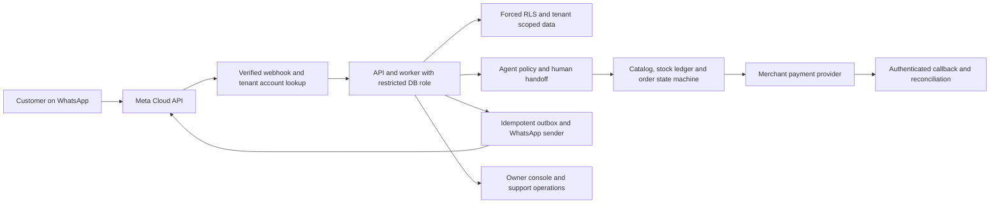

# PLAN: Production path to the first paid Kenyan pilot

> **Status:** proposal for human review. This is a plan, not implementation or
> evidence of launch readiness. No source code, tests, or production systems are
> changed by this document. Protected-zone edits begin only after an explicit
> human “go”.

## Executive recommendation

Do not rewrite SocialERP or wait for every roadmap feature. Keep the modular
monolith and make one safe, measurable offer for Nairobi social sellers:

**WhatsApp-first, concierge-onboarded order handling for a small cohort, with a
7-calendar-day trial and an affirmative monthly subscription choice.**

The repository already contains substantial catalog, stock, order, payment,
delivery, CRM, agent, and owner-console code. The launch gap is proving that
these pieces work with separate real merchants, real provider accounts, and a
production runtime. The shortest responsible route is:

1. Make the current branch’s status and verification evidence trustworthy.
2. Enforce tenant isolation in the actual API and worker database roles.
3. Route WhatsApp messages through each merchant’s own verified account.
4. Close payment, privacy, authentication, and subscription-verification gaps.
5. Prove the flow on migrated staging data and official provider sandboxes.
6. Invite three merchants first; expand to ten only after the first cohort is
   stable.

This can create value in Kenya: the Communications Authority’s 2024–25 survey
reports WhatsApp at 20.2% of e-commerce order placement and mobile money at
65.7% of preferred e-commerce payments. These figures support channel fit;
they do not prove that merchants will pay for SocialERP. That must be measured
in the pilot. [CA survey report](https://www.ca.go.ke/sites/default/files/2025-12/Customer%20Satisfaction%20Survey%20Report%202024-2025.pdf)

**Schedule:** the listed M0–M6 work represents roughly 12–21 engineer-days,
with some legal, provider, and operations work parallelizable. For one
experienced engineer with founder/operator work in parallel, use 2–4 weeks as
the current elapsed planning range, then add the merchant’s seven-calendar-day
trial. Meta review, merchant eligibility, provider onboarding, legal
classification, and unexpected defects can extend this. This is a planning
range, not a release promise.

## Goal and non-goals

**Goal:** safely accept and serve a small number of Kenyan businesses using
their own WhatsApp accounts, handle a bounded order workflow, demonstrate
measurable value, and collect the first verified SocialERP subscription
payments.

**Non-goals for the first paid pilot:**

- Rewriting the backend, splitting microservices, or building a complete ERP
  dashboard.
- Instagram, TikTok, bulk marketing, L3 autonomous optimization, or a broad
  multi-country launch.
- Pooling merchant sales proceeds in SocialERP’s account.
- Charging an unverified transaction fee or promising automatic Daraja go-live.
- Claiming 30-minute self-serve onboarding before it has been measured.
- Treating ten pilot merchants as statistically representative of Kenya.

## Classification

- **Type:** production hardening, channel/payment integration, pilot operations,
  and commercial validation.
- **Risk:** high. This work touches tenant isolation, customer data, payment
  state, authentication, and paid entitlements.
- **Complexity:** high but bounded. The proposed sequence reuses the existing
  modular monolith and puts acceptance gates between security-sensitive steps.
- **Protected zones:** database isolation, authentication, payment/billing,
  privacy/consent, security tests, evals, and CI gates require human approval
  before their implementation changes.

## Current repository baseline

The code baseline inspected for this plan was HEAD `a39db67`, before this new
plan file was added. The plan is currently uncommitted. The recorded project
state is not sufficiently current to act as release evidence:

- `docs/STATE.md` reports HEAD `c4e9317`; the security plan records a later
  gate at `7c28a79` with 1,018 tests and evals 8/8. Neither record proves the
  current HEAD `a39db67` is green.
- `docs/BUSINESS_PLAN.md`, `docs/PRICING_STRATEGY.md`,
  `apps/dashboard/src/lib/pricing.json`, `docs/STATE.md`, and the trial/billing
  plans disagree about whether billing is implemented, whether trial lasts
  7 or 14 days, whether SocialERP adds transaction fees, and what paid tiers
  include.
- RLS policies exist, but the runtime API configuration uses the table-owner
  role and the policies are not forced. Registration also writes tenant rows
  without setting tenant context. This is not yet a database-enforced
  cross-tenant boundary.
- WhatsApp/Instagram webhook routing and senders still use global account
  configuration. This is not proven multi-merchant account routing.
- The billing route records a caller-supplied payment reference and can apply
  the paid plan immediately. A well-formed M-Pesa reference is not proof that
  SocialERP received payment.
- The refresh-token cookie change is partial: the token is still returned in
  browser-readable JSON. The cookie alone does not close that exposure.
- The uncertainty ledger has stale entries in both directions. U51/U52
  erasure behavior has related code changes, but the ledger still reports
  surviving channel data as open. Treat it as unresolved until current-schema
  tests and a stored-data inventory prove otherwise.
- The approved F2 billing plan and `docs/STATE.md` describe payment-verified
  plan changes, but the current route records a caller-supplied reference and
  applies the plan in the same request. The code path does not establish that
  funds arrived or that a platform operator approved them. M0 must adjudicate
  this against the approved plan and record whether it is a regression or
  stale documentation; until then, paid-plan activation is blocked.
- `docs/THREAT_MODEL.md` describes RLS as mitigated and makes fixed claims
  about ODPC registration, a seven-year retention default, and a required
  DPIA. Reconcile these claims against the deployed runtime and current
  counsel-reviewed requirements before treating them as controls.
- The WhatsApp owner console exists; a full operational dashboard does not.
  The first cohort uses the WhatsApp owner console plus concierge support and
  must not be sold as having a completed dashboard.
- The local Compose configuration is a development setup. No production
  deployment profile, restore drill, or production provider approval is
  evidence-backed in this review.

**Readiness assessment:** technically promising pilot candidate; not ready for
real multi-tenant customer data or automated live payments yet. No tests were
run for this plan.

## Market and value hypothesis

### Customer and problem

Start with Nairobi social sellers whose business already runs through
WhatsApp, has repeat inquiries and catalog stock, and has roughly 50–500
monthly orders. Qualify for visible pain: missed messages, duplicated or
oversold stock, manual payment checks, repeated delivery-status questions, or
no reliable order history.

Recruit one primary category and, at most, one adjacent category for the first
ten merchants. Choose the primary category from discovery interviews using
message/order frequency, stock complexity, urgency of the pain, and willingness
to pay. Fashion/beauty and phone accessories are candidate groups in the
existing business plan, not proven winners.

### Value delivered

The launch promise should be concrete and auditable:

- Reply to approved FAQs from a merchant-confirmed catalog and business rules.
- Capture orders, validate price/stock deterministically, and create a
  traceable order.
- Keep the owner in control through shadow mode, review, and human handoff.
- Reduce missed inquiries and manual follow-up; show actual response time,
  orders handled, and owner time saved.
- Offer customer payment through the merchant’s own approved provider path;
  SocialERP does not hold or combine merchant funds.

The alternatives to test in interviews are the seller’s current WhatsApp
inbox plus notebook/spreadsheet, a separate stock/POS app, and a generic
messaging automation service. The proposed differentiation is one controlled
flow from conversation to confirmed catalog/stock, order, payment state, and
delivery update. Do not sell “the whole ERP” as the launch benefit; prove that
this specific flow saves time or recovers orders first.

Kenya’s CA survey also records delivery cost and fraud/scams among leading
e-commerce challenges. This supports testing trusted payment and delivery
workflows, but it does not establish demand for a particular SaaS price.
The ILO’s Kenya digital-business guide describes a small-business example of
missed WhatsApp orders and stock-planning difficulty; treat it as an
illustrative case, not market sizing. [ILO, Embracing digital in Kenya](https://www.ilo.org/sites/default/files/2024-11/24030-ILOP-Embracing-digital-Kenya-report-v1-5-D.pdf)

### Profitability hypothesis

SocialERP may be commercially attractive if subscription price exceeds
variable service cost and the product measurably saves owner time or recovers
sales. There is not yet measured willingness-to-pay, acquisition cost, churn,
support time, model cost, gross margin, or customer lifetime value. Therefore:

- Do not use current projected MRR, CAC, LTV, or gross margin as facts.
- Track subscription cash actually received, not payment references submitted.
- Track per-tenant model/provider charges, infrastructure allocation, onboarding
  and support minutes, payment costs, and refunds.
- Calculate tenant contribution as collected subscription revenue minus
  provider/message/model costs, allocated hosting, support labor, refunds, and
  acquisition cost. Calculate break-even paid tenants from measured monthly
  fixed costs divided by measured contribution per tenant.
- Do not add a SocialERP per-order fee during the pilot. It conflicts with the
  current public pricing file and adds reconciliation/legal complexity before
  willingness-to-pay is known.
- Use KES 2,999 and KES 7,999 only as existing price hypotheses until the
  included features are corrected and merchants interviewed. The first paid
  package must have one clear price and only features that work.
- Scale only when measured contribution margin is positive and support is
  repeatable. Do not infer profitability from gross subscription MRR.

For context, four paid Starter subscriptions at KES 2,999 would yield KES
11,996 monthly gross revenue; four at KES 7,999 would yield KES 31,996.
These are arithmetic examples before provider, infrastructure, support, tax,
and acquisition costs, not forecasts.

## Seven-day trial and subscription proposal

The requested seven-day trial is a sound experiment if it is clear, useful,
and does not silently expose merchants or customers to risk.

### Trial rules

1. **Duration:** seven consecutive calendar days in Africa/Nairobi. This
   intentionally supersedes the currently recorded 14-day policy only after
   explicit human approval and coordinated implementation.
2. **Start event:** the clock begins only after all readiness checks are
   complete: the merchant’s WhatsApp account is connected and verified,
   catalog prices and business rules are confirmed, a test order is completed,
   the privacy/retention notice is presented, and the owner explicitly approves
   going live. Signup or provider-approval delays do not burn trial days.
3. **Scope:** one WhatsApp business account and one owner seat during trial.
   L0 shadow mode first; L1 FAQs after the owner confirms catalog/rules. L2
   order/payment automation is enabled only for merchants who pass the pilot
   safety gate and opt in explicitly. The paid pilot offer has up to three
   seats, but the trial grants one seat. Instagram, TikTok, bulk marketing,
   L3, and API access remain off.
4. **Cost control:** before any production model/provider traffic, set a
   provisional hard per-tenant and total pilot spend cap from current provider
   prices and an explicit founder-approved KES budget. Enforce and alert on
   both caps. Tune them after staging and observed pilot costs; do not choose a
   magic cap without a stated budget and cost basis. A cap hit stops further
   model spend and uses a holding path/handoff when channel rules permit; it
   does not disable audit, export, safety, or privacy functions.
5. **Trial terms:** no payment card, no automatic charge, no surprise setup fee,
   and no SocialERP transaction fee during the pilot. State what is included,
   the trial end time, and what happens at expiry before the owner approves
   launch.
6. **End of trial:** provide clear owner reminders before expiry through the
   dashboard/email or a permitted, approved message route; do not send an
   out-of-window WhatsApp message without an eligible approved template. The
   owner affirmatively selects a paid plan and pays SocialERP through a
   separately verified platform collection path. Until trusted provider
   confirmation or operator approval with reconciliation exists, do not grant
   paid entitlements. A submitted reference alone is not verification.
7. **Expiry experience:** preserve owner access to export and data-rights
   tools. Do not keep answering on a plan the owner did not accept. A customer
   holding response may be sent only when current WhatsApp policy permits it;
   outside the service window, send only an approved eligible template. If no
   permitted send exists, stop automated sending and hand the conversation to
   the owner without a proactive customer message.
8. **Fairness:** extend the trial only for a documented SocialERP/provider
   outage that consumed usable time. Audit the extension. Do not use hidden
   trial extensions to disguise weak activation.

### Subscription shape for the pilot

Before launch, publish one WhatsApp-only package matching the real feature
set. Do not charge for Instagram, API, or L3 features that are not operational
and enforced. The recommended price hypothesis for cohort one is a new
**WhatsApp Transact Pilot SKU at KES 7,999/month**: one WhatsApp business
account, up to three seats after conversion, L1 answers, and L2 order flow
after owner opt-in and the safety gate. Instagram, API access, bulk marketing,
and L3 are excluded. This is intentionally distinct from the existing
Professional plan, which currently lists WhatsApp, Instagram, API access,
three seats, and L2. The new SKU must be represented and enforced in the
server entitlement model, pricing UI, terms, and subscription workflow before
it is offered. Do not relabel the existing Professional SKU.

KES 7,999 is a test price, not validated willingness-to-pay. Before invites,
interview merchants about the delivered workflow, disclose the actual price,
and confirm that the cohort accepts this specific offer. If evidence does not
support it, choose and approve a different single pilot price before launch.
The trial exercises the same core workflow but grants only one owner seat.
Trusted payment confirmation or a platform operator’s audited, reconciled
approval must precede paid activation. Merchant sales payments remain
separate and go directly to the merchant’s provider.

The seven-day policy intentionally reopens the previously recorded U60/U73
decision: the current design is 14 days from channel connect with WhatsApp
L1+L2 and a conditional extension. Before implementation, explicitly decide
and replace the duration, start event, trial autonomy, extension rule, and
no-referral rule in the ADR, uncertainty ledger, billing service/expiry
scheduler, UI, terms, and support script. Existing trial rows must not be
silently shortened, extended, or restarted: inspect whether real trial
accounts exist, preserve their paid/active time, and define an audited
grandfather/transition rule before migration.

## Derivation and invariants

1. **Shorten time to learning, not safety.** WhatsApp is already used for
   Kenyan e-commerce orders, and the repository has more WhatsApp workflow
   code than a production onboarding proof. Focusing on one channel shortens
   feedback time without requiring a rewrite.
2. **The database must enforce tenant boundaries.** Application query filters
   alone are insufficient. The runtime role must not own tenant tables, and
   forced RLS must apply on the exact sessions used by APIs and workers.
3. **Account identity must be tenant-specific.** Every inbound provider
   account ID maps to exactly one active tenant connection; every outbound
   send uses that connection’s protected credential and account ID.
4. **No unverified money state.** Customer payment callbacks must be
   authenticated, idempotent, matched to expected amount/order, and
   reconciled. A merchant-entered subscription reference is only a claim until
   verified.
5. **No silent automation or data hostage.** The default is L0. Owners
   expressly approve higher autonomy. At trial expiry, send a holding response
   only when current channel rules permit it; otherwise stop automated sending
   and hand off to the owner. Export and legally required privacy actions
   remain available after expiry.
6. **LLM output is never authoritative for money or stock.** Deterministic
   catalog, pricing, stock-ledger, and order-state code remains authoritative.
   Low confidence means clarify or hand off.
7. **Real data only after launch gates.** Develop and test with synthetic data.
   Production customer data enters only after a documented lawful basis,
   required notices and applicable channel/marketing opt-ins, retention,
   isolation, logging, access, and rollback controls are demonstrated.
8. **A small pilot is a learning instrument.** Ten merchants can reveal
   onboarding and value problems but cannot establish nationwide demand or
   stable unit economics.

## Options considered

| Option | Description | Benefits | Costs/risks | Decision |
|---|---|---|---|---|
| A. Finish all roadmap phases before launch | Complete Instagram, TikTok, L3, dashboard, billing and load program first | Broad product and polished sales story | Delays customer evidence; encourages building features before proving a beachhead | Reject for first launch |
| B. WhatsApp concierge pilot with hard safety gates | Secure runtime and account routing; onboard 3 merchants manually; expand to 10; sell one clear subscription | Fastest route to real value and paid learning; humans catch onboarding gaps | Founder support is intensive; Meta/provider/legal dependencies remain | **Choose** |
| C. Sandbox-only until full production UI and all approvals | No real customers until complete self-serve onboarding and every planned feature is ready | Lowest short-term operational exposure | Slowest learning and revenue; not required to prove the core workflow | Keep as fallback if a hard gate fails |

## Architecture and integration shape

Keep a modular monolith. Separate by domain and tenant boundary, not by
deploying microservices prematurely.

## Worked merchant example

Njeri runs a Nairobi clothing shop and receives orders through WhatsApp. The
team verifies that she controls the business account, connects it through the
official onboarding flow, imports a synthetic/test catalog first, then has her
confirm prices, sizes, stock, delivery areas, and reply rules. A test customer
asks for a black hoodie in size M. In L0, the agent drafts the answer and Njeri
approves it. After she reviews the catalog and rules, L1 can answer availability
from that data. If she opts into L2 after the payment and tenant-isolation
gates, deterministic code validates the variant and stock, creates the order,
and requests payment through her own approved provider. A matching
authenticated callback updates payment state; otherwise the order stays
pending and an operator reviews it.

The seven-day clock starts only when the account is verified, the test order
works, the privacy notice and lawful-basis information are presented, and
Njeri approves go-live. On day six she sees order count, response time, support
minutes, and payment exceptions. On day seven, SocialERP does not auto-charge:
she chooses the single published WhatsApp plan and completes a separately
verified payment, or the channel moves to an eligible holding response and
human handoff. Outside the WhatsApp service window, no customer message is
sent unless the applicable approved-template rules permit it. Njeri retains
data export and privacy controls.

### Production components

- **API and worker:** stateless deploys with separate processes, explicit
  health/readiness checks, durable queue, and idempotent jobs.
- **Database:** managed PostgreSQL; migrations run before app rollout; runtime
  role is non-owner, non-superuser, and has no BYPASSRLS. Use restricted
  platform lookup functions for unauthenticated login/webhook discovery.
- **Queue/cache:** managed Redis or selected durable job backend, with
  queue-depth and failed-job alerts. Redis availability must not silently
  remove abuse protection.
- **Secrets:** managed secret storage, rotation procedure, per-environment
  credentials, and field encryption for provider tokens. No production secret
  in repository or logs.
- **Web delivery:** HTTPS for dashboard and callback endpoints, strict
  headers/CSP, controlled CORS, rate limits, and operator kill switch for
  tenant/channel/agent autonomy.
- **Observability:** traces with phone numbers and message bodies redacted;
  metrics for first response, webhook failure, callback delay, reconciliation,
  queue depth, LLM cost, tenant spend, and handoffs.
- **Recovery:** automated backups plus a tested restore into an isolated
  environment; incident, rollback, credential-rotation, and data-subject
  request runbooks.

### Integration rules

**WhatsApp:** use Meta’s current official Cloud API and Embedded Signup. Before
coding to an assumed version or Coexistence behavior, verify current Meta
eligibility, App Review/permissions, Kenya phone support, terms, template
rules, service windows, and Graph API version. Meta’s Embedded Signup
documentation identifies app review and advanced permission access as
prerequisites for release. Apply early; approval timing is an external
dependency. [Meta Embedded Signup collection](https://www.postman.com/meta/whatsapp-business-platform/documentation/du6gzjv/embedded-signup)

**M-Pesa:** use the existing provider interface. Start with sandbox and a
merchant’s own approved Till/Paybill or a verified, legally reviewed
aggregator path. Production requires live provider credentials and callbacks
over HTTPS; handle delayed/missing callbacks with status query and daily
reconciliation. Safaricom describes STK as asynchronous and Transaction Status
as a secondary reconciliation mechanism for missing callbacks.
[Safaricom Daraja Getting Started](https://developer.safaricom.co.ke/apis/GettingStarted) ·
[Safaricom Transaction Status](https://developer.safaricom.co.ke/apis/TransactionStatus)

**SocialERP subscription collection:** separate account, ledger, callback,
permissions, and reconciliation from merchant customer payments. No
co-mingling, shared merchant shortcode, or entitlement on an unverified
reference.

**Instagram and TikTok:** remain disabled for the initial cohort. Add only
after tenant routing, approval, eligibility, and message-policy tests are
proven for the relevant Kenyan business accounts.

## Ordered implementation steps

Each coding step is a small reviewable commit. Write its acceptance tests
before its implementation. Do not weaken existing assertions. Protected-zone
edits require human approval first. Development and staging use synthetic
records. This plan does not authorize the first real-data import, live
customer messaging, or live payment endpoint calls: each requires a separate
explicit user authorization after the launch gates. Merchant consent and
provider approval are necessary product/legal conditions, but do not replace
that operating authorization.

### M0 — Freeze truth and make one release baseline (0.5–1 day)

1. Reconcile `docs/STATE.md`, `docs/MAP.md`, `docs/UNCERTAINTY.md`,
   `docs/THREAT_MODEL.md`, `docs/BUSINESS_PLAN.md`,
   `docs/PRICING_STRATEGY.md`, pricing JSON, and plans against current source,
   migrations, and commit history.
2. Mark each uncertainty as resolved, open, or decision-required with
   evidence. Specifically check U76/U77/U82, U78/U79/U80/U81, U51/U52, and
   trial U60/U73. For billing, compare the route/service against the approved
   F2 plan and tests; record whether the discrepancy is a code regression or
   stale documentation before fixing it.
3. Run the project gate on a clean, named SHA and capture real output. A
   previous green run is not current proof.
4. Freeze pilot scope, the seven-day rule, one paid offer, and owners for
   Meta/provider/legal work. Record non-trivial decisions as ADRs.

**Acceptance:** one consistent current status; current green project gate with
SHA and output; no public page or document promises an unimplemented feature.

### M1 — Make tenant isolation and sessions real (2–3 days)

1. Configure API and worker with the restricted runtime database role.
2. Force RLS on tenant tables and verify every policy uses tenant context.
   Set context transaction-locally on the same session for API requests and
   background jobs.
3. Keep platform-scoped tables such as invite codes and the billing reference
   ledger outside tenant RLS only where required. Add an explicit exception
   inventory and narrow, audited functions for registration, login, verified
   webhook lookup, and operator billing review. Do not give the app role
   BYPASSRLS.
4. Prove cross-tenant read/write denial on a database built from Alembic
   migrations, using the actual runtime role, for API and worker paths.
5. Remove the browser-readable refresh-token response path; verify cookie,
   CSRF, CSP, logout, and refresh behavior.
6. Update rate-limiter policy for Redis failure and cover externally reachable
   costly/authenticated paths. Alert on degraded mode; do not silently claim
   distributed protection when unavailable.

**Acceptance:** no runtime process owns tenant tables or bypasses RLS;
cross-tenant attempts fail closed after migration; registration and webhook
lookups work only through approved paths; platform-scoped exceptions are
listed and separately access-controlled; browser JavaScript cannot read a
refresh token; auth and rate-limit tests exercise deployment configuration.

### M2 — Tenant-owned WhatsApp accounts (3–5 engineering days, plus review)

1. Add a tenant-scoped channel-account record with provider identifiers,
   encrypted credential reference, connection status, token expiry, granted
   scopes, and revocation time.
2. Implement the current official Embedded Signup handshake and store only
   minimum credentials. Make reconnect, token rotation, permission loss, and
   disconnect explicit states.
3. Resolve inbound tenant identity from verified provider account ID; reject
   unknown, disabled, duplicate, or revoked IDs.
4. Make outbound sends use that tenant-owned account record. Remove global
   single-account assumptions from pilot paths.
5. Add idempotency, webhook signature tests, 24-hour window checks,
   template-only out-of-window behavior, marketing opt-in checks, and a kill
   switch.
6. Prove two test tenants can receive and send independently, with no
   credential or message crossover.

**Acceptance:** two independent test businesses route correctly; unknown or
revoked accounts cannot access a tenant; tokens never appear in logs, traces,
or API responses; Meta test-account and fake-provider contract tests pass.

### M3 — Close payment and paid-subscription correctness (2–4 days)

1. Keep merchant funds on the merchant’s provider account; confirm the
   aggregator/collection model with Kenyan payments counsel before onboarding.
2. Correct SaaS subscription flow: a submitted reference enters
   `pending_verification`; only trusted provider confirmation or platform
   operator approval with reconciliation activates a paid period. Add a
   minimal authenticated platform-operator role/workflow separate from tenant
   owners, with actor identity, MFA or equivalent privileged-session control,
   amount/plan matching, statement/provider evidence, and append-only audit.
   A tenant owner may submit evidence but cannot approve that evidence.
3. Add idempotent callbacks, expected-amount matching, duplicate/late-event
   handling, missing-callback status query, and daily reconciliation alerts.
4. Confirm refunds remain human-approved and all money decisions auditable.
5. Verify current Safaricom production requirements and each selected
   aggregator’s authorization/status. Keep real-money endpoint activity gated
   until the owner explicitly authorizes it.

**Acceptance:** fabricated, duplicate, wrong-amount, late, or missing
references/callbacks do not grant or double-grant access; provider confirmation
and manual operator approval are distinct auditable states; a tenant owner
cannot self-approve; mismatches alert an operator and block automation.

### M4 — Resolve data protection and production operations (2–4 days, parallel)

1. Re-test erasure behavior, including outbox payloads and WhatsApp
   contacts/messages; reconcile U51/U52 only after tests and stored-data
   inventory confirm actual state.
2. Map customer data and subprocessors: database, queue, logs/traces, backups,
   media, Meta, model provider, hosting, and support access.
3. Minimize onboarding collection. Do not request owner IDs, KRA PINs,
   registration papers, or customer exports unless a specific provider/legal
   requirement is confirmed and purpose/retention are documented.
4. Have Kenyan counsel classify controller/processor roles, ODPC registration
   duty, profiling/DPIA requirement, cross-border safeguards, notices/consent,
   retention, deletion, and breach obligations. ODPC regulations provide a
   threshold exemption only when both turnover/revenue and employee conditions
   are met, with listed-purpose exceptions; do not assume this project
   qualifies. [ODPC registration regulations](https://www.odpc.go.ke/wp-content/uploads/2024/03/THE-DATA-PROTECTION-REGISTRATION-OF-DATA-CONTROLLERS-AND-DATA-PROCESSORS-REGULATIONS-2021.pdf)
5. Create staging/production profiles with separate secrets, HTTPS, managed
   database/queue, backups, tested restore, monitoring, alert ownership, and
   incident/rollback runbooks.
6. Update the threat model using real deployment and processor details.
   Explicitly correct its claims that RLS is already mitigated, registration
   is categorically mandatory, seven-year retention is a universal default,
   and a DPIA is always required; replace each with verified runtime facts or
   counsel-reviewed requirements.

**Acceptance:** data inventory and retention schedule; counsel classification
and required actions recorded; documented lawful basis and required notices
are in place, with distinct opt-in where channel policy or direct marketing
requires it; rights/opt-out/erasure behavior matches code; staging restore
succeeds; telemetry redacts PII; launch, rollback, and incident owners are
named.

### M5 — Align the seven-day trial and one honest subscription (1–2 days)

1. After approval, update trial settings, billing service, start event,
   expiration scheduler, migration/backfill behavior, and public terms from
   14-day/channel-connect to seven days after ready-to-go-live. Preserve
   existing active/paid time under an audited transition rule.
2. Add a distinct WhatsApp Transact Pilot SKU to the plan/entitlement model,
   billing API, pricing data/UI, terms, and operator workflow. Prove that its
   included features (one WhatsApp account, up to three paid seats, L1/L2,
   no Instagram/API/L3/bulk marketing) are enforced. Verify U80/U81 in code
   before changing the ledger.
3. Gate every advertised feature: channels, autonomy, seats, API access, and
   support. Do not list Instagram or L3 in the launch offer.
4. Add owner-visible trial start/end, included features, usage, payment
   instructions, reminders, and affirmative upgrade action.
5. At expiry, send a customer holding response only if current channel rules
   allow it; otherwise stop automated sending and hand off to the owner.
   Keep export, consent/opt-out, and deletion available.
6. Verify subscription payment to SocialERP separately from customer payments.
   No auto-charge. Require trusted confirmation or the privileged,
   operator-approved workflow in M3.

**Acceptance:** trial clock does not start at signup or during blocked
onboarding; transition of any existing trial is audited; seven-day expiry,
extension, and channel-window tests pass; trial does not roll into a charge;
paid entitlement follows verified payment/approval only; the pilot SKU is
enforced end-to-end; pricing page, terms, API behavior, and support script
agree.

### M6 — Prove the full flow before customer data (1–2 days)

1. Build a fresh database with migrations, not ORM-created metadata.
2. Run contract replay against fake Meta and Daraja/aggregator servers.
3. Exercise onboarding, catalog confirmation, L0 shadow, approved L1,
   permitted L2 order, concurrent last-item stock, customer payment, duplicate
   callback, callback timeout/status query, human handoff, trial expiry, and
   subscription confirmation.
4. Run evals for English, Swahili, Sheng-aware language, price/stock accuracy,
   injection resistance, and handoff. Wrong-price and wrong-stock rate must
   be zero on the release set.
5. Run load/recovery checks at initial targets; perform backup restore and
   simulate provider, LLM, and queue outages.
6. Run final `make check` and record actual output at a clean, named SHA.
   Skeptic and scribe review the result. This plan does not claim those checks
   have run.

**Acceptance:** project gate green at release SHA; migration, RLS, payment,
channel-routing, trial, consent, and abuse tests pass; zero wrong-price/stock
eval errors; restore and outage procedures work; critical alerts reach named
operators.

### M7 — Concierge pilot and measured conversion (7-day trial per merchant)

1. After separate explicit authorization for real-data onboarding and live
   channel operation, invite three Nairobi businesses with recurring WhatsApp
   demand. Confirm their authority to connect the account and the applicable
   lawful basis, notices, and channel opt-ins for customer-message processing.
2. Onboard one at a time with the owner: confirm catalog, prices, stock,
   business rules, payment path, privacy notice/lawful-basis record, applicable
   channel/marketing opt-ins, handoff contact, and test order.
3. Start trial only after readiness checks and explicit go-live. Begin L0;
   enable L1 after owner sign-off; enable L2 only after safety gate and
   explicit owner opt-in.
4. Review daily for the first week. Record failures, support time,
   infrastructure/model cost, payment result, and complaints.
5. Expand to ten merchants only after the first three complete the seven-day
   period without a P0 security/privacy/money event and reliability thresholds
   below are met.
6. Ask each owner for a paid decision with exact price/features. Verify
   payment before activation. Request a case study separately and only with
   written consent.

**Acceptance to expand:** 3/3 merchants onboard without tenant/account
crossover; at least 2/3 reach first order handled within 48 hours; median first
response under 30 seconds for eligible conversations; no wrong-price or
wrong-stock event; no unresolved money discrepancy or high-severity
privacy/security event; owner can hand off, export, and stop automation.

### M8 — Decide whether to scale (after cohort one)

Continue only if the cohort supplies enough evidence of recurring merchant
value:

- At least 7/10 reach a first order handled in the system within 48 hours.
- At least 4/10 make a verified paid subscription decision at the stated price.
- At least 3 paying merchants remain active through the next billing period
  before treating conversion as durable.
- Positive contribution margin per paid tenant after provider, LLM, hosting,
  onboarding, support, and payment costs.
- No cross-tenant leak, wrong-price/stock event, unverified payment, or
  unresolved high-severity privacy incident.
- Measure onboarding minutes, first response, STK success, stock variance,
  owner hours saved, weekly active owners, complaints, support minutes, trial
  conversion, failed activation, and churn.

Treat ten merchants as directional evidence. If customers value the service
but price/margin fails, simplify costs, narrow the offer, or test pricing with
a new cohort before broad acquisition. If fewer than 7/10 activate or fewer
than 4/10 pay, stop paid acquisition and fix onboarding/value first.

## Blast radius and rollback

| Work | Blast radius | Rollback |
|---|---|---|
| Status/pricing/docs reconciliation | Sales claims, trial terms, project state | Revert the document commit; do not invite prospects until consistent |
| Restricted DB role and forced RLS | Every API/worker database path | Roll back deployment only before accepting real customer data; keep migrations additive; pause onboarding and use manual support |
| Per-tenant Meta account routing | All inbound/outbound WhatsApp traffic | Disable tenant/channel with kill switch; use owner-managed app and manual order handling |
| Billing and trial gates | Access to agent features and paid plans | Stop new upgrades; keep export/privacy rights available; issue holding reply and handoff |
| Production deployment | Availability and data recovery | Roll back app image; keep migrations backward-compatible; restore only under incident runbook |
| Pilot autonomy | Customer promises, reservations, payment requests | Set tenant to L0/disabled; stop automated sends/payment requests; reconcile orders manually |

Never roll back by deleting audit evidence, hiding a failed payment, or
re-enabling an unsafe role. A rollback that may affect customer data requires
an incident owner and explicit go/no-go.

## Incentive review

| Stakeholder | Benefit / incentive | Abuse or harm path | Control |
|---|---|---|---|
| Business owner | Fewer missed orders, less repetitive work, better stock visibility | Over-trusts agent or exposes customer lists | L0 default, confirmation gates, audit, export and disable controls |
| Customer | Faster answers, clear price/payment/order status | Wrong price, unsolicited marketing, privacy disclosure | Catalog-only answers, opt-in marketing, human route, tenant-scoped lookup |
| Staff | Less repetitive messaging | Excessive worker surveillance through logs | Role limits, data minimization, transparent policy |
| Rider | Clearer delivery instructions | Personal safety and address/payment fraud | Share only necessary details; verify risky changes; escalate |
| Fraudster | May try forged callbacks, fake references, prompt injection, stolen credentials | False paid state, stock loss, disclosure | Signature/amount validation, idempotency, scoped tools, operator reconciliation |
| Meta | Safe messaging and compliant partner ecosystem | Quality-rating damage from spam or bad templates | Official API, consent/window rules, template governance, kill switch |
| Safaricom/PSP | Accurate authorized payments and reconciliation | Unapproved funds custody or weak callback handling | Merchant-owned settlement, approval, auditable reconciliation |
| Regulator/data subject | Lawful, explainable, minimal processing | Unclear roles, unneeded ID collection, weak deletion | Counsel review, rights process, retention map, least collection |
| Competitor/market | More reliable small-seller operations | Price pressure or copied feature claims | Compete on verified outcomes, local support, transparent pricing |

## Failure modes and detection

| Failure | Detection | Immediate response |
|---|---|---|
| RLS blocks signup or worker jobs | Restricted-role integration tests and staging smoke | Pause onboarding; use manual support; fix grants/context before retry |
| RLS fails open or tenant is misattributed | Cross-tenant adversarial tests, mapping alerts, audit review | Stop automated sends/payments; isolate tenants; incident review |
| Meta review or number eligibility delayed | Application status and merchant checklist | Keep trial clock paused; use sandbox demo; never simulate live connection |
| Token expires/revokes or wrong account maps | Auth metrics and webhook mapping alert | Disconnect affected tenant, notify owner, rotate/reconnect officially |
| Callback missing, late, duplicate, or mismatched | Callback-gap/reconciliation queue | Hold paid/order state for review; never infer success from request acceptance |
| Subscription reference fabricated | No trusted payment event/operator reconciliation | Leave plan pending; request provider trace and review manually |
| LLM or queue unavailable | Health checks, queue age, gateway/cost alert | Safe holding reply and handoff; no autonomous order/payment action |
| Trial expires during conversation | Trial-expiry test and owner reminder | Send a holding reply only if channel rules permit; otherwise stop automated sending and hand off; preserve export/data rights |
| Trial cost exceeds unit economics | Per-tenant spend and conversation-cost dashboard | Enforce the pre-live hard cap; adjust it later from measured costs; stop model spend at the cap and keep safety/handoff paths |
| Customer data survives erasure unexpectedly | Data inventory and erasure tests | Contain access; follow approved retention/incident procedure; record outcome |
| Restore or migration fails | Staging restore drill and migration check | Do not deploy; repair forward migration and prove again in staging |
| Activation or paid conversion misses target | Funnel dashboard and interviews | Pause ads/expansion; fix onboarding or value before spending more |

## Acceptance criteria for launch

The first real merchant may be invited only when all are true:

1. Current `make check` is green and recorded at the exact release SHA.
2. Cross-tenant read/write tests pass through real API/worker paths using the
   restricted production database role and migrated schema.
3. Two WhatsApp sandbox tenants prove independent routing, protected
   credentials, webhook verification, opt-out, and message-window handling.
4. Payment callbacks, status-query fallback, amount/order matching,
   replay/late-event handling, and reconciliation pass in official sandbox;
   live money is separately gated by approvals and explicit authorization.
5. Subscription activation requires trusted payment confirmation or audited
   operator verification; a caller-supplied string cannot grant access.
6. Browser session responses do not disclose refresh tokens and auth behavior
   is tested.
7. Trial start/end, package, terms, pricing, and expiry behavior agree across
   API, UI, and support script.
8. Data inventory, notices, retention, consent/opt-out, erasure, export,
   processor contracts, and counsel decisions are recorded; unnecessary
   identity/KRA documents are not collected.
9. Staging restore, alert delivery, incident response, credential rotation,
   and tenant/channel kill switch are rehearsed.
10. The owner approves the exact launch message, autonomy level, and
    customer-facing payment/delivery language.
11. The user has separately and explicitly authorized first real-data import,
    live customer messaging, and any live payment endpoint activity after all
    other launch gates. This plan is not that authorization.

## Assumptions and confidence

| ID | Assumption | Confidence | Treatment |
|---|---|---:|---|
| A1 | WhatsApp-first is the fastest useful Kenyan pilot because existing code is strongest there and CA data shows meaningful WhatsApp ordering | 0.85 | Verify in first ten interviews; do not imply it proves demand |
| A2 | Three merchants can be recruited through founder relationships for a concierge cohort | 0.55 | Founder confirms names before engineering completion; schedule remains conditional |
| A3 | Meta Embedded Signup/Coexistence can be approved for target Kenyan business accounts | 0.45 | External blocker: verify current official eligibility and secure one test account before promising onboarding |
| A4 | Merchants will pay KES 7,999/month for the exact WhatsApp Transact Pilot offer | 0.45 | Not a forecast; measure with explicit offers and verified payments |
| A5 | Current code implements parts of billing, entitlements, trial-abuse controls, and erasure, but documented behavior may not match the actual boundary | 0.55 | Reconcile source, tests, migrations, and ledger at M0; keep billing and erasure blocked until proven |
| A6 | The 12–21 engineer-day / 2–4 week planning range is achievable without external-review delays | 0.45 | Planning estimate; record actual effort and revise weekly |
| A7 | SocialERP can operate the initial service without holding merchant customer funds | 0.80 | Confirm chosen PSP/settlement model with Kenyan payments counsel |

The below-0.6 assumptions concern timing, partner eligibility, and demand.
They are stop/decision gates, not facts to build around: do not promise
Embedded Signup, publish a fixed price as validated, or set a launch date until
those questions have evidence.

## Human decisions required before implementation

1. Approve this pilot scope and protected work sequence: tenant isolation,
   authentication, subscription verification, privacy, and trial policy.
2. Approve whether to supersede U60/U73’s 14 days from channel connect,
   WhatsApp L1+L2 trial, and conditional extension with the proposed seven
   days after readiness, L0/L1 default, L2 by explicit opt-in, and
   outage-only extension.
3. Approve one paid offer before invitations. Recommendation: a new
   WhatsApp-only Transact Pilot SKU, proposed at KES 7,999/month with no
   SocialERP transaction fee; it excludes Instagram, API, L3, and bulk
   marketing. This is a willingness-to-pay hypothesis, not an established
   price.
4. Assign owners for Meta app review, provider onboarding, and Kenyan
   privacy/payment counsel.

No implementation starts until the human replies with “go”. Provider approval
and live endpoints remain separate authorization gates.

## Docs to update during implementation

- `docs/STATE.md`, `docs/MAP.md`, and `docs/UNCERTAINTY.md` — current HEAD,
  gate evidence, resolved/stale findings, and pilot stage.
- `docs/THREAT_MODEL.md` — deployed database roles, channel credentials,
  payment/data processors, current risks, and incident controls.
- `docs/BUSINESS_PLAN.md`, `docs/PRICING_STRATEGY.md`, pricing JSON, terms,
  privacy notice, and onboarding checklist — one consistent seven-day offer
  and honest feature/pricing claims.
- ADRs for trial start/expiry, paid subscription verification, tenant-owned
  channel credentials, data retention/erasure, and production deployment.
- `docs/RUNBOOKS/` — onboarding, billing verification, provider callbacks,
  incident/rollback, backup restore, token rotation, and trial expiry.
- Module READMEs, `docs/MAP.md`, and the change/learning record.

## External references checked for this proposal

- Communications Authority of Kenya, Customer Satisfaction Survey 2024–2025:
  [official report](https://www.ca.go.ke/sites/default/files/2025-12/Customer%20Satisfaction%20Survey%20Report%202024-2025.pdf)
- International Labour Organization, Embracing digital in Kenya (2024):
  [official report](https://www.ilo.org/sites/default/files/2024-11/24030-ILOP-Embracing-digital-Kenya-report-v1-5-D.pdf)
- ODPC, Data Protection (Registration of Data Controllers and Data Processors)
  Regulations (2021):
  [official regulations](https://www.odpc.go.ke/wp-content/uploads/2024/03/THE-DATA-PROTECTION-REGISTRATION-OF-DATA-CONTROLLERS-AND-DATA-PROCESSORS-REGULATIONS-2021.pdf)
- Meta, WhatsApp Business Platform Embedded Signup:
  [Meta API collection](https://www.postman.com/meta/whatsapp-business-platform/documentation/du6gzjv/embedded-signup)
- Safaricom, Daraja:
  [Getting Started](https://developer.safaricom.co.ke/apis/GettingStarted) ·
  [Transaction Status](https://developer.safaricom.co.ke/apis/TransactionStatus)
